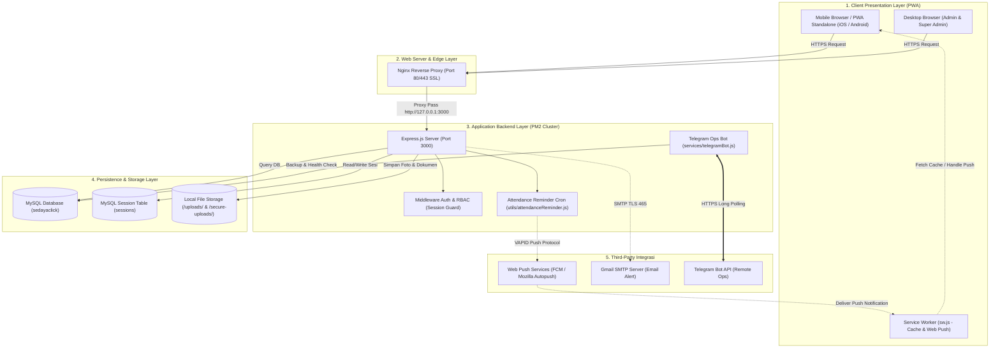

# 01. Project Overview: SedayaClick

| Metadata | Keterangan |
| :--- | :--- |
| **Nama Sistem** | SedayaClick — Sistem Presensi & Penggajian Karyawan PWA |
| **Pemilik Sistem** | PT Rancang Bangun Sedaya [TERVERIFIKASI: docs/SRS-DOKUMENTASI-SEDAYACLICK.md] |
| **Pemilik Dokumen** | Project Manager [PERLU KONFIRMASI: Nama Spesifik PM] |
| **Status Aplikasi** | Production (Aktif digunakan di operasional perusahaan) |
| **Versi Dokumen** | 1.0.0 (As-Built Documentation) |
| **Tanggal Analisis** | 23 November 2026 |
| **Sumber Analisis** | Commit `f374140` (Branch `main`) |

---

## 1. Latar Belakang & Masalah yang Diselesaikan

Sebelum implementasi sistem digital SedayaClick, operasional pencatatan kehadiran dan pengajuan cuti/izin di PT Rancang Bangun Sedaya menghadapi sejumlah inefisiensi bisnis:
1. **Risiko Manipulasi Kehadiran (*Buddy Punching / Titip Absen*)**:
   Absensi manual atau berbasis kertas rentan terhadap manipulasi waktu dan kehadiran fiktif. SedayaClick menyelesaikan hal ini dengan mewajibkan pengambilan swafoto langsung melalui kamera perangkat (*live WebRTC snapshot*) dan penguncian koordinat satelit GPS (*geolocation*) pada setiap transaksi Clock In dan Clock Out.
2. **Keterlambatan Penanganan Pengajuan Izin, Cuti, Sakit, dan Lembur**:
   Pengajuan konvensional membutuhkan formulir fisik yang memakan waktu persetujuan berhari-hari. SedayaClick menyediakan modul pengajuan digital instan dengan alur persetujuan berjenjang (*Pending*, *Under Review*, *Approved*, *Rejected*), dilengkapi notifikasi email dan push notification ke perangkat manajer.
3. **Kompleksitas Shift Kerja Dinamis & Libur Rolling (Roster)**:
   Unit bisnis operasional tertentu (seperti perhotelan/villa Casa Nawasena dan unit SSV) menerapkan jadwal kerja bergilir (*roster*) yang bervariasi setiap hari (Shift Pagi, Siang, SSV, Setengah Hari, Sore) dengan jadwal libur tidak tetap (*rolling day off*). SedayaClick memfasilitasi manajemen jadwal bulanan melalui impor/ekspor file matriks Excel (`.xlsx`) dan otomatisasi penentuan shift harian karyawan.
4. **Rekapitulasi Jam Kerja & Penggajian yang Memakan Waktu**:
   Perhitungan durasi jam kerja, keterlambatan, dan lembur secara manual sering memicu selisih hitung pada akhir bulan. SedayaClick menghitung seluruh metrik secara otomatis hingga presisi detik (`HH:mm:ss`) dan menyediakan ekspor instan dalam format CSV dan Excel yang siap digunakan untuk pemrosesan penggajian (*payroll*).

---

## 2. Stakeholder Sistem

Berdasarkan implementasi kode sumber dan konfigurasi hak akses:

| Stakeholder | Peran dalam Sistem | Kepentingan & Tanggung Jawab Utama | Rujukan Kode |
| :--- | :--- | :--- | :--- |
| **Karyawan Operasional** | Aktor Pengguna (`employee`) | Melakukan absensi masuk/pulang harian, lembur mandiri, mengajukan izin/cuti/sakit, dan memantau jadwal roster harian. | [TERVERIFIKASI: middleware/auth.js:18, public/employee/] |
| **Admin Manager Divisi** | Aktor Pengguna (`admin_manager`) | Memantau kehadiran tim secara harian, menyetujui/menolak pengajuan izin/cuti/lembur, dan mengunggah matriks roster bulanan. | [TERVERIFIKASI: routes/admin.js:26, public/admin/] |
| **Super Admin / HRD Eksekutif**| Aktor Pengguna (`super_admin`) | Mengelola seluruh pengguna (aktivasi akun), data master (divisi, jabatan, shift), memantau KPI organisasi, dan mengunduh laporan penggajian. | [TERVERIFIKASI: routes/superadmin.js:11, public/superadmin/] |
| **Tim DevOps / IT Support** | Operator Sistem (Server Level) | Mengelola deployment VPS, server web Nginx, proses PM2, sertifikat SSL, pemeliharaan database via Bot Telegram, dan pipeline CI/CD. | [TERVERIFIKASI: services/telegramBot.js, .github/workflows/deploy.yml] |
| **Manajemen / Direksi** | Konsumen Laporan Eksekutif | Mengamati tren kedisiplinan karyawan, absensi tepat waktu vs terlambat, dan efektivitas jam kerja lintas divisi. | [TERVERIFIKASI: routes/superadmin.js:18-100] |

---

## 3. Ruang Lingkup Sistem (Scope)

### 3.1 Fitur yang Ada di Kode (*In-Scope / As-Built*)
- **Manajemen Akun & Sesi**:
  - Pendaftaran mandiri karyawan (status awal `pending`) [TERVERIFIKASI: routes/auth.js:65-98].
  - Login multi-peran dengan sesi terenkripsi yang disimpan di MySQL (`sessions`) [TERVERIFIKASI: server.js:76-92].
  - Rate limiting anti-brute force pada endpoint login dan registrasi [TERVERIFIKASI: routes/auth.js:14-47].
  - Penyimpanan kata sandi ganda: hash bcrypt untuk otentikasi login dan enkripsi AES-256-CBC untuk inspeksi administratif Super Admin [TERVERIFIKASI: routes/auth.js:85-86, utils/crypto.js].
- **Presensi Karyawan**:
  - Clock In & Clock Out harian dengan foto wajah WebRTC dan koordinat GPS [TERVERIFIKASI: routes/attendance.js:127-310].
  - Presensi Lembur Langsung (*Direct Overtime Attendance*) dengan swafoto, titik lokasi, keterangan tugas, dan lampiran berkas hasil kerja [TERVERIFIKASI: routes/attendance.js:312-460].
  - Kalkulasi presisi detik durasi kerja (`work_duration_seconds`), keterlambatan (`late_duration_seconds`), dan lembur (`overtime_seconds`) [TERVERIFIKASI: utils/timeCalc.js].
- **Pengajuan & Persetujuan (Workflow)**:
  - Pengajuan jenis Izin, Cuti, Sakit, dan Lembur [TERVERIFIKASI: routes/submissions.js:16-85].
  - Validasi aturan pengajuan H-3 untuk Cuti dan Izin operasional [TERVERIFIKASI: routes/submissions.js:46-59].
  - Pencatatan rencana serah terima tugas (*handover plan*) untuk pengajuan cuti [TERVERIFIKASI: routes/submissions.js:63-65].
  - Persetujuan berjenjang: *Pending*, *Under Review*, *Approved*, *Rejected* beserta catatan reviewer [TERVERIFIKASI: routes/admin.js:128-167].
  - Modul pembuatan, pengeditan, dan penghapusan pengajuan oleh Admin Manager lintas divisi [TERVERIFIKASI: routes/admin.js:200-380].
- **Shift & Roster Operasional**:
  - Dukungan jenis shift: `fixed` (reguler tetap), `flexible_hours` (jam kerja fleksibel), dan `roster` (jadwal bergilir) [TERVERIFIKASI: config/db.js:76].
  - Template dan parser matriks Excel jadwal roster bulanan (kode: P, S, VK, VW, VH, R, PL, SAT, L/OFF) [TERVERIFIKASI: utils/rosterHelper.js:7-70, routes/admin.js:390-550].
  - Pengondisian tampilan antarmuka karyawan: widget jadwal roster hanya tampil bagi karyawan shift khusus [TERVERIFIKASI: routes/attendance.js:45-75, public/employee/js/employee.js:163-192].
- **Notifikasi & Pemantauan**:
  - Web Push Notification VAPID pada browser PWA perangkat karyawan [TERVERIFIKASI: routes/notifications.js:18-61].
  - Background scheduler pengingat absensi otomatis H-15 menit sebelum jam shift masuk dan pulang [TERVERIFIKASI: utils/attendanceReminder.js].
  - Pengiriman email notifikasi antrean pengajuan pending kepada manajer via Gmail SMTP [TERVERIFIKASI: utils/mailer.js].
  - SedayaClick Telegram Ops & Maintenance Bot untuk manajemen server remote, backup database dump `.sql.gz`, arsip foto `.tar.gz`, dan restart PM2 [TERVERIFIKASI: services/telegramBot.js].
- **Pelaporan & Keamanan Berkas**:
  - Filter laporan multi-periode (harian, mingguan, bulanan, rentang kustom) dan multi-divisi [TERVERIFIKASI: routes/reports.js:22-56].
  - Ekspor laporan dalam format CSV dan Excel `.xlsx` [TERVERIFIKASI: utils/exportGenerator.js].
  - Rute akses berkas terproteksi `/secure-uploads/*` yang membatasi hak akses file hanya untuk pemilik atau manajer berwenang [TERVERIFIKASI: routes/secureUploads.js].

### 3.2 Fitur di Luar Ruang Lingkup (*Out of Scope / Tidak Ditemukan di Kode*)
Berdasarkan pemeriksaan menyeluruh pada repositori:
1. **Mesin Penggajian Penuh (*Payroll Engine / Slip Gaji Otomatis*)**:
   Meskipun nama aplikasi mencantumkan "Absensi & Penggajian", sistem di kode saat ini **hanya** menghasilkan data mentah durasi kerja, keterlambatan, lembur, dan jumlah kehadiran. Tidak ditemukan tabel perhitungan nominal rupiah, potongan BPJS, PPh 21, tunjangan, atau penerbitan berkas Slip Gaji PDF [ASUMSI: kalkulasi nominal gaji dilakukan di luar sistem melalui ekspor Excel].
2. **Face Recognition Biometrik Otomatis (AI/ML Face Matching)**:
   Aplikasi mengambil dan menyimpan foto swafoto kamera secara utuh (`clock_in_photo`, `clock_out_photo`), namun **tidak** ada algoritma pendeteksi kecocokan wajah atau integrasi API pengenalan wajah (seperti AWS Rekognition, FaceAPI, atau OpenCV) [TERVERIFIKASI: routes/attendance.js].
3. **Deteksi Fake GPS / Rooted Device / Mock Location Guard**:
   Sistem membaca koordinat latitude/longitude murni dari browser Web Geolocation API tanpa mekanisme deteksi bypass mock location atau integrasi native SDK [TERVERIFIKASI: public/js/geolocation.js].
4. **Aplikasi Native Seluler (Android APK / iOS IPA)**:
   Tidak ditemukan direktori Flutter, React Native, Java/Kotlin, atau Swift. Aplikasi bekerja 100% sebagai Progressive Web Application (PWA) di browser seluler [TERVERIFIKASI: public/manifest.json, public/sw.js].

---

## 4. Platform dan Lingkungan Sistem

| Lingkungan | Spesifikasi / Konfigurasi | Rujukan Kode |
| :--- | :--- | :--- |
| **Platform Target** | Web Browser & Mobile PWA (iOS Safari, Android Chrome) | [TERVERIFIKASI: public/manifest.json] |
| **Operating System VPS**| Ubuntu 20.04 / 22.04 LTS (x86_64) | [TERVERIFIKASI: deploy/setup-vps.sh:4] |
| **Hosting Provider** | VPS Rumahweb / Cloud Hosting | [TERVERIFIKASI: deploy/setup-vps.sh:16] |
| **Domain Resmi** | `sedayaclick.cloud` (dengan sertifikat Let's Encrypt HTTPS) | [TERVERIFIKASI: deploy/setup-vps.sh:24, server.js:47] |
| **Zona Waktu Server** | `Asia/Jakarta` (Waktu Indonesia Barat / UTC+7) | [TERVERIFIKASI: deploy/setup-vps.sh:51, routes/attendance.js:23-28] |

---

## 5. Ringkasan Arsitektur Teknologi

