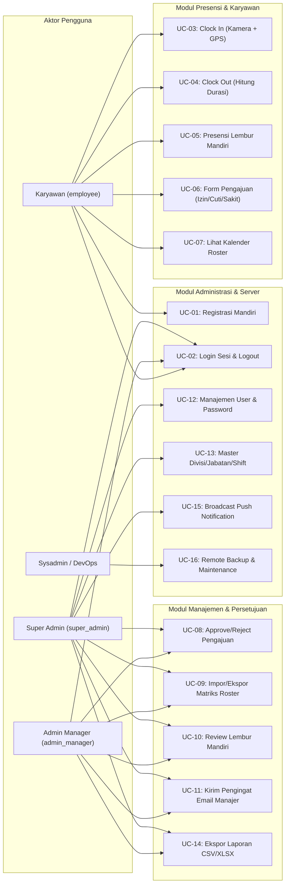

# 02. Software Requirements Specification (SRS) As-Built

| Metadata | Keterangan |
| :--- | :--- |
| **Sistem** | SedayaClick — Sistem Presensi & Penggajian Karyawan PWA |
| **Versi Dokumen** | 1.0.0 (As-Built) |
| **Tanggal Analisis** | 23 November 2026 |
| **Sumber Analisis** | Commit `f374140` (Branch `main`) |
| **Status Dokumen** | Terverifikasi Berdasarkan Kode Sumber |

---

## 1. Aktor Sistem & Matriks Hak Akses (RBAC)

Sistem mengimplementasikan tiga peran pengguna (*Role-Based Access Control*) yang dikontrol secara ketat melalui middleware [TERVERIFIKASI: middleware/auth.js:18-29]:

| ID Aktor | Nama Peran | Kode Teknis | Deskripsi & Batas Kewenangan |
| :--- | :--- | :--- | :--- |
| **ACT-01** | **Karyawan** | `employee` | Pengguna akhir operasional. Hanya dapat mencatat presensi harian, presensi lembur mandiri, mengajukan perizinan sendiri, dan melihat jadwal/berkas miliknya. |
| **ACT-02** | **Admin Manager** | `admin_manager` | Manajemen menengah divisi. Berwenang meninjau, menyetujui, menolak, mengedit, dan membuat pengajuan lintas divisi, serta mengunggah/mengunduh jadwal roster tim operasional. |
| **ACT-03** | **Super Admin** | `super_admin` | Administrator tingkat tinggi (HRD/Direksi). Menguasai penuh seluruh modul: manajemen akun & kata sandi, persetujuan user pending, master data divisi/jabatan/shift, dashboard KPI, ekspor laporan, dan broadcast notifikasi. |

### Matriks Hak Akses Modul (RBAC Matrix)
[TERVERIFIKASI: routes/*.js & middleware/auth.js]

| Modul / Fitur Sistem | Karyawan (`employee`) | Admin Manager (`admin_manager`) | Super Admin (`super_admin`) | Rujukan Berkas |
| :--- | :---: | :---: | :---: | :--- |
| **Registrasi Mandiri & Login** | Ya | Ya | Ya | `routes/auth.js` |
| **Aktivasi Akun User Pending** | Tidak | Tidak | **Ya** | `routes/superadmin.js:174` |
| **CRUD & Edit Password User** | Tidak | Tidak | **Ya** | `routes/superadmin.js:224-315` |
| **Clock In & Clock Out Harian** | **Ya** | Tidak | Tidak | `routes/attendance.js:127,247` |
| **Presensi Lembur Mandiri** | **Ya** | Tidak | Tidak | `routes/attendance.js:312,385` |
| **Lihat Kalender Roster Pribadi** | **Ya** (Shift Khusus) | Tidak | Tidak | `routes/attendance.js:85` |
| **Pengajuan Izin/Cuti/Sakit/Lembur** | **Ya** (Milik Sendiri) | **Ya** (Atas Nama Tim) | **Ya** (Atas Nama Tim) | `routes/submissions.js:16, routes/admin.js:203` |
| **Approve / Reject / Review Pengajuan** | Tidak | **Ya** | **Ya** | `routes/admin.js:128` |
| **Review Presensi Masuk Lembur** | Tidak | **Ya** | **Ya** | `routes/admin.js:774` |
| **Upload / Download Template Roster**| Tidak | **Ya** | **Ya** | `routes/admin.js:390,480` |
| **Master Data (Divisi/Jabatan/Shift)**| Tidak | Tidak | **Ya** | `routes/superadmin.js:322-448` |
| **Dashboard KPI Organisasi** | Tidak | Tidak | **Ya** | `routes/superadmin.js:21` |
| **Unduh Rekap Laporan (CSV/XLSX)** | Tidak | **Ya** (Divisinya) | **Ya** (Semua Divisi) | `routes/reports.js:63-125` |
| **Kirim Email Pengingat Manajer** | Tidak | **Ya** | **Ya** | `routes/admin.js:988, routes/superadmin.js:105` |
| **Broadcast Web Push Notification** | Tidak | Tidak | **Ya** | `routes/notifications.js:125` |
| **Akses File Foto (/secure-uploads)** | **Ya** (Hanya Milik Sendiri)| **Ya** (Semua Berkas) | **Ya** (Semua Berkas) | `routes/secureUploads.js:33-49` |

---

## 2. Kebutuhan Fungsional (Functional Requirements)

Prioritas kebutuhan fungsional ditentukan dengan standar MoSCoW [ASUMSI berdasarkan ketergantungan operasional kode]:

| ID Kebutuhan | Modul | Deskripsi Kebutuhan Fungsional | Aktor Terkait | Rujukan Implementasi Kode | Prioritas MoSCoW |
| :--- | :--- | :--- | :--- | :--- | :---: |
| **FR-01** | Autentikasi | Sistem harus mengizinkan calon karyawan melakukan pendaftaran mandiri dengan status awal `pending`. | Tamu / Calon User | [TERVERIFIKASI: routes/auth.js:65-98] | Must Have |
| **FR-02** | Autentikasi | Sistem harus memvalidasi kredensial login (email & kata sandi hash bcrypt) dan menetapkan sesi cookie aman (`sedayaclick_sid`). | Semua Aktor | [TERVERIFIKASI: routes/auth.js:108-160] | Must Have |
| **FR-03** | Autentikasi | Sistem harus membatasi percobaan login gagal maksimal 5 kali dalam 15 menit per kombinasi IP dan email. | Tamu / Karyawan | [TERVERIFIKASI: routes/auth.js:14-32] | Must Have |
| **FR-04** | Presensi | Sistem harus merekam Clock In karyawan berupa waktu server, swafoto kamera WebRTC, koordinat GPS, dan catatan opsional. | Karyawan | [TERVERIFIKASI: routes/attendance.js:127-245] | Must Have |
| **FR-05** | Presensi | Sistem harus memastikan karyawan hanya dapat melakukan Clock In 1 kali dalam 1 hari kalender. | Karyawan | [TERVERIFIKASI: routes/attendance.js:150-152] | Must Have |
| **FR-06** | Presensi | Sistem harus merekam Clock Out karyawan, menghitung durasi kerja total (`work_duration_seconds`), keterlambatan, dan durasi lembur shift. | Karyawan | [TERVERIFIKASI: routes/attendance.js:247-310] | Must Have |
| **FR-07** | Presensi | Sistem harus mendukung presensi lembur langsung mandiri (*Direct Overtime Clock In/Out*) dengan alasan tugas dan unggahan berkas hasil kerja. | Karyawan | [TERVERIFIKASI: routes/attendance.js:312-460] | Should Have |
| **FR-08** | Presensi | Sistem harus mendeteksi jadwal roster dinamis harian (kode P, S, VK, VW, VH, R, PL, SAT, L/OFF) untuk karyawan shift khusus. | Karyawan | [TERVERIFIKASI: routes/attendance.js:45-74, utils/rosterHelper.js] | Must Have |
| **FR-09** | Pengajuan | Karyawan dapat mengajukan formulir izin, cuti, sakit, dan lembur secara mandiri dengan lampiran dokumen opsional. | Karyawan | [TERVERIFIKASI: routes/submissions.js:16-85] | Must Have |
| **FR-10** | Pengajuan | Sistem harus menolak pengajuan cuti dan izin yang diajukan kurang dari H-3 sebelum tanggal pelaksanaan. | Karyawan | [TERVERIFIKASI: routes/submissions.js:46-59] | Must Have |
| **FR-11** | Pengajuan | Sistem harus mewajibkan pengisian rencana serah terima pekerjaan (*handover plan*) untuk pengajuan cuti. | Karyawan | [TERVERIFIKASI: routes/submissions.js:63-65] | Must Have |
| **FR-12** | Persetujuan | Admin Manager dan Super Admin dapat meninjau, menyetujui, menolak, atau menandai `under_review` pada antrean pengajuan beserta catatan alasan. | Admin Manager, Super Admin | [TERVERIFIKASI: routes/admin.js:128-167] | Must Have |
| **FR-13** | Roster | Admin Manager dan Super Admin dapat mengunduh template matriks roster Excel bulanan dan mengunggah kembali file yang telah terisi ke database. | Admin Manager, Super Admin | [TERVERIFIKASI: routes/admin.js:390-550] | Must Have |
| **FR-14** | Master Data | Super Admin dapat melakukan aktivasi, penonaktifan, pembuatan akun manual, serta melihat/mengubah kata sandi pengguna. | Super Admin | [TERVERIFIKASI: routes/superadmin.js:174-315] | Must Have |
| **FR-15** | Master Data | Super Admin dapat mengelola master divisi, master jabatan, dan master pengaturan jam kerja/shift (`shift_settings`). | Super Admin | [TERVERIFIKASI: routes/superadmin.js:322-448] | Must Have |
| **FR-16** | Dashboard | Super Admin dapat melihat metrik KPI harian/mingguan/bulanan (tepat waktu, terlambat, pending pengajuan, total aktif) dan grafik tren absensi. | Super Admin | [TERVERIFIKASI: routes/superadmin.js:21-101] | Should Have |
| **FR-17** | Pelaporan | Sistem dapat mengekspor rekap absensi, pengajuan, dan lembur ke dalam berkas CSV dan Microsoft Excel `.xlsx`. | Admin Manager, Super Admin | [TERVERIFIKASI: routes/reports.js:63-125, utils/exportGenerator.js] | Must Have |
| **FR-18** | Notifikasi | Sistem harus mengirimkan Web Push Notification pengingat absensi otomatis pada H-15 menit sebelum shift dimulai dan sebelum shift berakhir. | Karyawan | [TERVERIFIKASI: utils/attendanceReminder.js:46-150] | Should Have |
| **FR-19** | Notifikasi | Super Admin dapat mengirimkan siaran (*broadcast*) notifikasi pesan instan ke seluruh karyawan atau divisi tertentu. | Super Admin | [TERVERIFIKASI: routes/notifications.js:125-225] | Could Have |
| **FR-20** | Notifikasi | Sistem dapat memicu pengiriman email rekapitulasi antrean pengajuan pending kepada manajer melalui koneksi Gmail SMTP. | Admin Manager, Super Admin | [TERVERIFIKASI: utils/mailer.js:10-97, routes/admin.js:988] | Should Have |
| **FR-21** | Pemeliharaan| Sistem menyediakan Telegram Bot untuk eksekusi backup SQL, backup arsip foto, dan cek kesehatan server secara remote. | DevOps / Sysadmin | [TERVERIFIKASI: services/telegramBot.js:1-950] | Could Have |

---

## 3. Kebutuhan Non-Fungsional (Non-Functional Requirements)

| ID NFR | Kategori | Kebutuhan Non-Fungsional | Rujukan Bukti di Repositori |
| :--- | :--- | :--- | :--- |
| **NFR-01** | **Performa & Skalabilitas** | Backend dijalankan dalam mode PM2 Cluster (`instances: 'max'`) untuk memanfaatkan seluruh core CPU server secara optimal. | [TERVERIFIKASI: ecosystem.config.js:6-7] |
| **NFR-02** | **Performa Jaringan** | Nginx dikonfigurasi dengan kompresi Gzip level 6 untuk seluruh aset statis, JSON, CSS, dan skrip PWA guna mereduksi konsumsi bandwidth seluler. | [TERVERIFIKASI: deploy/nginx-sedayaclick.conf:10-14] |
| **NFR-03** | **Keamanan Sesi** | Cookie sesi Express dikonfigurasi dengan atribut `httpOnly: true` dan `sameSite: 'lax'` untuk mencegah pencurian token via serangan Cross-Site Scripting (XSS). | [TERVERIFIKASI: server.js:87-88] |
| **NFR-04** | **Perlindungan Berkas** | Berkas foto absensi dan bukti pengajuan tidak disajikan melalui direktori publik statis biasa, melainkan melalui rute otorisasi `/secure-uploads/` dengan verifikasi session ownership. | [TERVERIFIKASI: routes/secureUploads.js:18-100] |
| **NFR-05** | **Integritas Upload** | Ukuran file unggahan dibatasi maksimal 10 MB per transaksi dengan validasi whitelist ekstensi gambar/dokumen (JPEG, PNG, WEBP, PDF) guna mencegah eksekusi file liar. | [TERVERIFIKASI: utils/uploadConfig.js:15-38, server.js:119-125] |
| **NFR-06** | **Ketersediaan (PWA Offline Shell)**| Service Worker (`sw.js`) meng-cache App Shell PWA sehingga tampilan antarmuka dapat dibuka seketika meskipun jaringan seluler tidak stabil. | [TERVERIFIKASI: public/sw.js:5-24] |
| **NFR-07** | **Presisi Zona Waktu**| Seluruh penentuan tanggal transaksi dan jam clock-in/out dinormalisasi ke zona waktu Waktu Indonesia Barat (`Asia/Jakarta` / UTC+7). | [TERVERIFIKASI: routes/attendance.js:23-28, utils/attendanceReminder.js:18-29] |
| **NFR-08** | **Lokalisasi Bahasa**| Bahasa antarmuka pengguna, format penanggalan, dan pesan kesalahan disajikan dalam Bahasa Indonesia formal. | [TERVERIFIKASI: public/index.html, utils/mailer.js:31-43] |

---

## 4. Aturan Bisnis Sistem (Business Rules)

Berikut adalah daftar aturan bisnis formal yang mengikat alur kerja sistem presensi:

| ID Aturan | Topik Aturan | Deskripsi Lengkap Aturan Bisnis | Rujukan Kode Sumber |
| :--- | :--- | :--- | :--- |
| **BR-01** | **Batas Absensi Harian** | Satu karyawan hanya diizinkan memiliki tepat 1 rekaman absensi reguler per hari kalender (`attendance_date`). Pelanggaran integritas dicegah melalui *unique compound key* di database. | [TERVERIFIKASI: config/schema.sql:68, routes/attendance.js:150-152] |
| **BR-02** | **Kewajiban Swafoto & GPS** | Clock In dan Clock Out wajib menyertakan foto wajah yang diambil langsung dari kamera browser WebRTC serta koordinat GPS (latitude & longitude) yang aktif dan terkunci. Pengunggahan foto dari galeri ditolak. | [TERVERIFIKASI: routes/attendance.js:139-145] |
| **BR-03** | **Shift Reguler & Toleransi** | Karyawan shift tetap (Fixed) memiliki jam masuk default (misal 08:00 WIB) dengan batas toleransi keterlambatan (`tolerance_minutes`). Masuk setelah jam shift + toleransi dicatat sebagai `status = 'late'`. | [TERVERIFIKASI: utils/timeCalc.js:41-47, routes/attendance.js:173-198] |
| **BR-04** | **Shift Khusus / Roster** | Karyawan operasional dengan penugasan `shift_type = 'roster'` atau penugasan di `employee_schedules` mengikuti kode dinamis (P: 06:00-15:00, S: 13:00-22:00, VK: 08:00-17:00, VW: 08:00-17:00, VH: 08:00-13:00, R: 14:00-23:00). Pada shift siang/khusus, kedatangan sebelum jam mulai shift tidak dianggap terlambat. | [TERVERIFIKASI: utils/rosterHelper.js:7-70, routes/attendance.js:200-240] |
| **BR-05** | **Libur Terjadwal (Day Off)**| Karyawan yang tercatat memiliki kode `L` atau `OFF` atau flag `is_day_off = 1` di tabel roster dibebaskan dari kewajiban absensi harian dan tidak dikirimi push notification pengingat absensi. | [TERVERIFIKASI: utils/attendanceReminder.js:85-87, routes/attendance.js:195-200] |
| **BR-06** | **Kalkulasi Jam Kerja Presisi**| Durasi kerja dihitung otomatis saat Clock Out dalam hitungan detik: `work_duration_seconds = clock_out_time - clock_in_time`. Jika kepulangan melewati jam shift selesai, selisih detik dihitung sebagai `overtime_seconds`. | [TERVERIFIKASI: utils/timeCalc.js:54-69, routes/attendance.js:275-285] |
| **BR-07** | **Presensi Lembur Mandiri** | Karyawan dapat melakukan Clock In dan Clock Out Lembur Terpisah di luar jam shift normal, dengan syarat mengisi alasan penugasan dan mengunggah berkas bukti penyelesaian kerja (*work attachment*). Lembur ini berstatus `pending` dan memerlukan persetujuan manajer. | [TERVERIFIKASI: routes/attendance.js:312-460] |
| **BR-08** | **Aturan Pengajuan Cuti & Izin H-3**| Pengajuan cuti tahunan dan izin operasional wajib diajukan minimal 3 hari kalender sebelum tanggal pelaksanaan (`diffDays >= 3`). Sistem otomatis menolak pengajuan jika diajukan mendadak (< 3 hari). | [TERVERIFIKASI: routes/submissions.js:46-59] |
| **BR-09** | **Pengecualian Izin Sakit** | Pengajuan sakit dikecualikan dari aturan H-3 (dapat diajukan pada hari H atau setelahnya) dengan kewajiban melampirkan surat keterangan dokter / resep obat. | [TERVERIFIKASI: routes/submissions.js:46] |
| **BR-10** | **Rencana Serah Terima Cuti** | Setiap pengajuan cuti wajib melampirkan informasi serah terima tugas pekerjaan, meliputi: rincian rencana serah terima (`handover_plan`), nama rekan pengganti (`handover_to_name`), dan jabatan rekan pengganti (`handover_to_position`). | [TERVERIFIKASI: routes/submissions.js:63-65, config/db.js:47-50] |
| **BR-11** | **Siklus Status Persetujuan** | Setiap pengajuan memiliki 4 status: `pending` (menunggu), `under_review` (sedang ditinjau manajemen), `approved` (disetujui), dan `rejected` (ditolak). Setiap keputusan wajib menyertakan catatan peninjau (`review_note`). | [TERVERIFIKASI: routes/admin.js:133-142] |
| **BR-12** | **Konfigurasi Geofencing Kantor**| Variabel koordinat dan radius kantor (`OFFICE_LATITUDE`, `OFFICE_LONGITUDE`, `OFFICE_RADIUS_METERS`) didefinisikan pada `.env`. [CATATAN KODE: saat ini koordinat disimpan di database attendances, namun validasi radius pemblokiran clock-in bersifat opsional/future-proofing]. | [TERVERIFIKASI: .env.example:18-20, routes/attendance.js:142] |
| **BR-13** | **Pengondisian Widget Roster UI**| Widget jadwal harian dan tombol kalender roster sebulan penuh pada dashboard karyawan HANYA DITAMPILKAN bagi karyawan yang memiliki penugasan Shift Khusus / Roster. Karyawan reguler disajikan antarmuka bersih tanpa komponen roster. | [TERVERIFIKASI: routes/attendance.js:45-75, public/employee/js/employee.js:163-192] |
| **BR-14** | **Aksesibilitas Sesi & Password**| Super Admin memiliki wewenang untuk memeriksa kata sandi pengguna asli yang didekripsi dari kolom `visible_password` menggunakan algoritma AES-256-CBC untuk keperluan dukungan operasional karyawan. | [TERVERIFIKASI: routes/superadmin.js:150-170, utils/crypto.js] |

---

## 5. Daftar Use Case & Diagram Use Case

### 5.1 Katalog Use Case (Use Case Index)
- **UC-01**: Pendaftaran Akun Mandiri (`employee`)
- **UC-02**: Otentikasi & Login Sesi (`employee`, `admin_manager`, `super_admin`)
- **UC-03**: Melakukan Presensi Masuk (Clock In) (`employee`)
- **UC-04**: Melakukan Presensi Pulang (Clock Out) (`employee`)
- **UC-05**: Melakukan Presensi Lembur Mandiri (`employee`)
- **UC-06**: Mengajukan Izin / Cuti / Sakit / Lembur (`employee`)
- **UC-07**: Memeriksa Jadwal Roster & Libur Rolling Bulanan (`employee`)
- **UC-08**: Meninjau & Memutuskan Pengajuan Tim (`admin_manager`, `super_admin`)
- **UC-09**: Mengunggah & Memperbarui Matriks Roster Bulanan (`admin_manager`, `super_admin`)
- **UC-10**: Meninjau Presensi Lembur Langsung Tim (`admin_manager`, `super_admin`)
- **UC-11**: Mengirim Email Pengingat Pengajuan Pending (`admin_manager`, `super_admin`)
- **UC-12**: Mengelola Data Pengguna & Aktivasi Akun (`super_admin`)
- **UC-13**: Mengelola Master Divisi, Jabatan, dan Shift (`super_admin`)
- **UC-14**: Mengunduh Rekap Laporan Absensi (CSV/XLSX) (`admin_manager`, `super_admin`)
- **UC-15**: Mengirim Broadcast Push Notification (`super_admin`)
- **UC-16**: Melakukan Pemeliharaan & Backup Server Remote (`sysadmin` via Telegram Bot)

### 5.2 Diagram Use Case Sistem (Mermaid)

