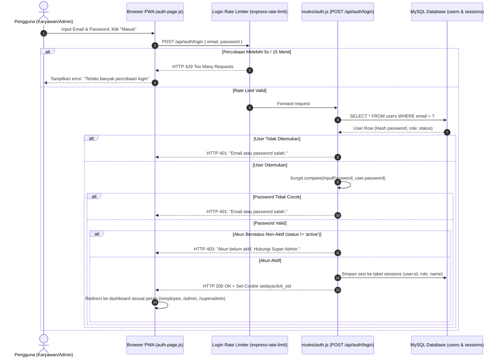
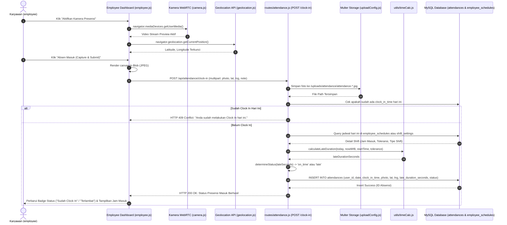
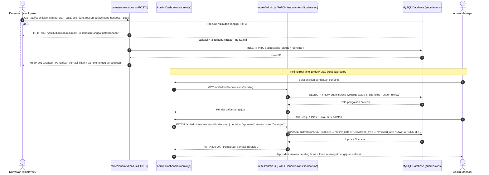
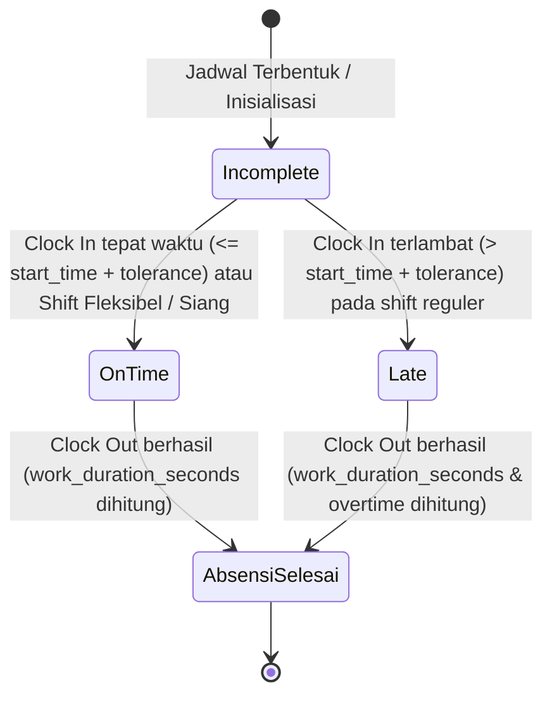
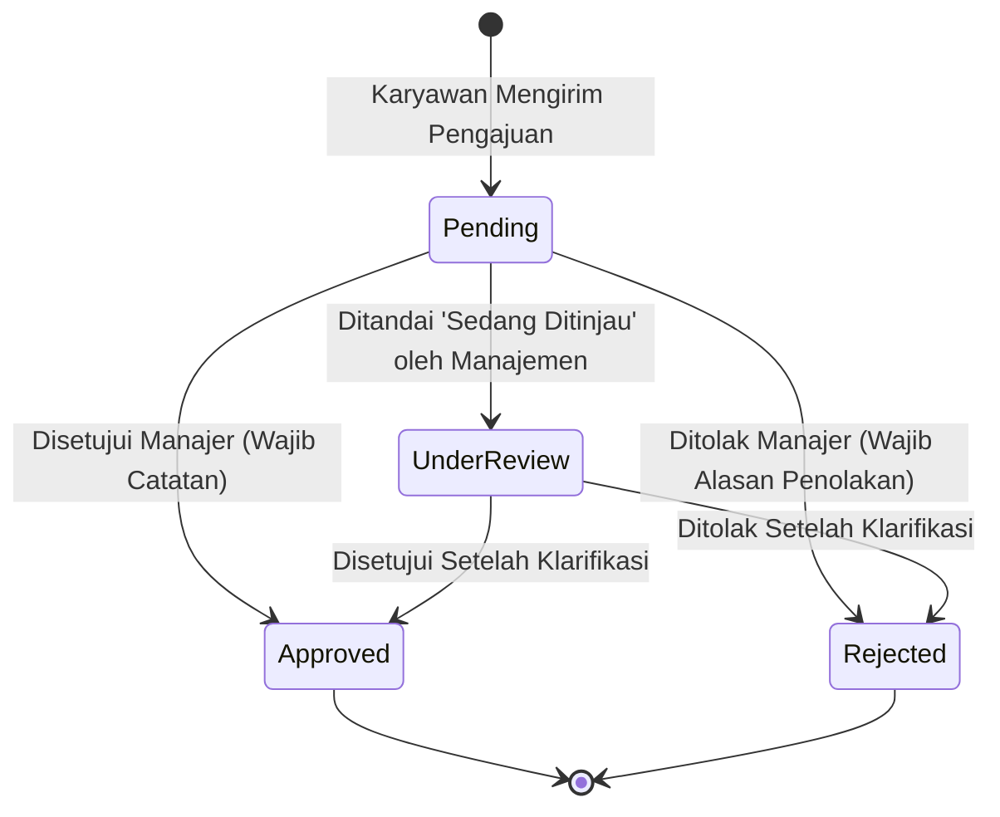
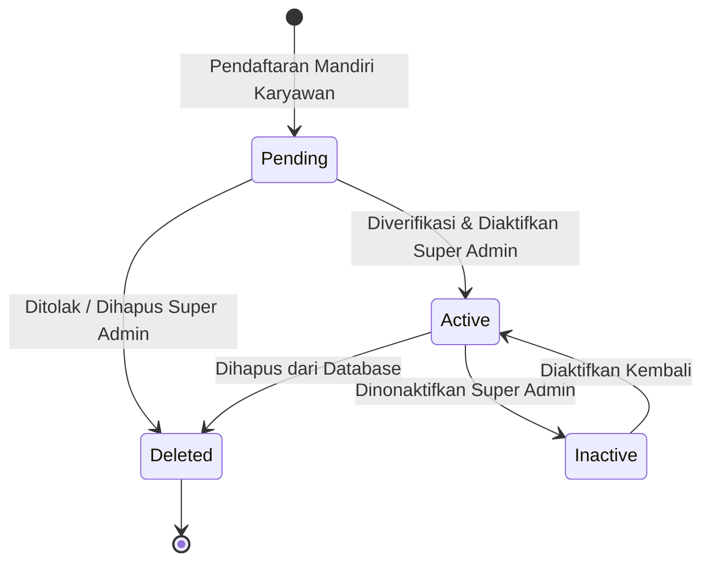

# 03. Software Design Document (SDD) As-Built

| Metadata | Keterangan |
| :--- | :--- |
| **Sistem** | SedayaClick — Sistem Presensi & Penggajian Karyawan PWA |
| **Versi Dokumen** | 1.0.0 (As-Built) |
| **Tanggal Analisis** | 23 November 2026 |
| **Sumber Analisis** | Commit `f374140` (Branch `main`) |
| **Status Dokumen** | Terverifikasi Berdasarkan Kode Sumber |

---

## 1. Arsitektur Sistem & Pola Desain

### 1.1 Pola Arsitektur (*Architectural Pattern*)
Aplikasi SedayaClick mengadopsi pola **Modular Monolith** dengan pendekatan **Layered Architecture** (Presentation, Routing & Middleware, Business Utilities & Service, dan Persistence).
- **Presentation Layer**: Static Progressive Web App (PWA) yang dilayani oleh Express static middleware dan Service Worker (`public/sw.js`). Client berkomunikasi dengan server murni melalui asynchronous JSON REST API menggunakan `fetch()`.
- **Routing & Middleware Layer**: Express Router modular (`routes/*.js`) yang dipagari oleh middleware autentikasi dan RBAC (`middleware/auth.js`) serta rate limiter (`express-rate-limit`).
- **Business Logic & Service Layer**: Kumpulan fungsi pembantu (*pure helper modules*) di `utils/` (`timeCalc.js`, `rosterHelper.js`, `exportGenerator.js`, `mailer.js`, `crypto.js`, `attendanceReminder.js`) serta background worker `services/telegramBot.js`.
- **Persistence Layer**: Basis data relasional MySQL diakses menggunakan connection pool `mysql2/promise` dengan *parameterized queries* murni (`?`) tanpa ORM berat, menghasilkan overhead komputasi yang sangat rendah.

### 1.2 Diagram Komponen Perangkat Lunak (Mermaid)

```mermaid
flowchart TD
    subgraph Client ["Client Browser / Mobile PWA"]
        UI_Login["Auth UI (index.html)"]
        UI_Emp["Employee Dashboard (employee/dashboard.html)"]
        UI_Adm["Admin Dashboard (admin/dashboard.html)"]
        UI_SA["Super Admin Dashboard (superadmin/dashboard.html)"]
        SW["Service Worker (sw.js - Cache & Push Receiver)"]
    end

    subgraph ServerApp ["Node.js + Express Application Engine"]
        EntryPoint["server.js (App Entry, Helmet, CORS, Error Handler)"]
        AuthMid["middleware/auth.js (requireAuth, requireRole, requireActiveAccount)"]
        
        subgraph APIRoutes ["REST API Routers"]
            R_Auth["routes/auth.js"]
            R_Att["routes/attendance.js"]
            R_Sub["routes/submissions.js"]
            R_Adm["routes/admin.js"]
            R_SA["routes/superadmin.js"]
            R_Rep["routes/reports.js"]
            R_Notif["routes/notifications.js"]
            R_Sec["routes/secureUploads.js"]
        end

        subgraph CoreHelpers ["Domain Logic & Utility Engine"]
            H_Time["utils/timeCalc.js (Durasi, Terlambat, Lembur)"]
            H_Roster["utils/rosterHelper.js (Matrix Parser & Codes)"]
            H_Mail["utils/mailer.js (SMTP Gmail Queue Sender)"]
            H_Crypto["utils/crypto.js (AES-256-CBC Two-Way Encrypt)"]
            H_Export["utils/exportGenerator.js (ExcelJS & CSV)"]
            H_Upload["utils/uploadConfig.js (Multer Storage & Whitelist)"]
        end

        subgraph Daemons ["Background Schedulers"]
            Sched_Att["utils/attendanceReminder.js (Cron 60s H-15 Min)"]
            Bot_Tele["services/telegramBot.js (Long Polling Bot)"]
        end
    end

    subgraph DataStorage ["Storage Engine"]
        MySQL_DB[("MySQL Database: sedayaclick")]
        MySQL_Sessions[("Table: sessions (Persistent Express Session)")]
        Local_FS[("File System: /uploads/ (attendance, submissions)")]
    end

    UI_Emp -->|API Requests| EntryPoint
    UI_Adm -->|API Requests| EntryPoint
    UI_SA -->|API Requests| EntryPoint
    UI_Login -->|API Requests| EntryPoint

    EntryPoint --> AuthMid
    AuthMid --> APIRoutes

    R_Att --> H_Time
    R_Att --> H_Roster
    R_Att --> H_Upload
    R_Adm --> H_Roster
    R_Adm --> H_Mail
    R_SA --> H_Crypto
    R_SA --> H_Mail
    R_Rep --> H_Export
    R_Sec --> Local_FS

    APIRoutes --> MySQL_DB
    EntryPoint --> MySQL_Sessions
    Sched_Att --> MySQL_DB
    Bot_Tele --> MySQL_DB
    Bot_Tele --> Local_FS
```

---

## 2. Sequence Diagram Alur Kunci Sistem

### 2.1 Alur Autentikasi & Login Sesi
[TERVERIFIKASI: routes/auth.js:108-160]

### 2.2 Alur Presensi Masuk (Clock In) dengan Swafoto & GPS
[TERVERIFIKASI: routes/attendance.js:127-245]

### 2.3 Alur Pengajuan Izin / Cuti & Persetujuan Manajer
[TERVERIFIKASI: routes/submissions.js:16-85, routes/admin.js:128-167]

---

## 3. State Transition Diagrams

### 3.1 Siklus Status Absensi Harian (`attendances.status`)
[TERVERIFIKASI: config/schema.sql:47, routes/attendance.js:180-235]

### 3.2 Siklus Status Pengajuan (`submissions.status` & `attendances.overtime_status`)
[TERVERIFIKASI: server.js:246-247, routes/admin.js:128-167]

### 3.3 Siklus Status Akun Pengguna (`users.status`)
[TERVERIFIKASI: routes/auth.js:90, routes/superadmin.js:174-200]

---

## 4. Algoritma Inti Sistem

### 4.1 Algoritma Kalkulasi Durasi Kerja, Keterlambatan, dan Lembur
Didefinisikan pada modul murni [TERVERIFIKASI: utils/timeCalc.js]:

1. **Durasi Keterlambatan (`calculateLateDuration`)**:
   - Input: `attendanceDate` (YYYY-MM-DD), `clockInTime` (Date), `shiftStartTime` (HH:mm:ss), `toleranceMinutes` (Integer).
   - Langkah:
     1. Bentuk objek `scheduledStart = Date(attendanceDate + "T" + shiftStartTime)`.
     2. Tambahkan menit toleransi: `scheduledStart.setMinutes(scheduledStart.getMinutes() + toleranceMinutes)`.
     3. Konversi selisih ke detik: `diff = (clockInTime.getTime() - scheduledStart.getTime()) / 1000`.
     4. Jika `diff > 0`, return `Math.floor(diff)` (durasi detik terlambat); jika tidak, return `0`.
2. **Durasi Lembur Shift Reguler (`calculateOvertime`)**:
   - Input: `attendanceDate`, `clockOutTime` (Date), `shiftEndTime` (HH:mm:ss).
   - Langkah:
     1. Bentuk objek `scheduledEnd = Date(attendanceDate + "T" + shiftEndTime)`.
     2. Hitung selisih: `diff = (clockOutTime.getTime() - scheduledEnd.getTime()) / 1000`.
     3. Jika `diff > 0`, return `Math.floor(diff)` (durasi lembur detik); jika tidak, return `0`.
3. **Format Durasi ke HH:mm:ss (`secondsToHMS`)**:
   - Input: `totalSeconds` (Numeric).
   - Hitung jam: `h = Math.floor(absSeconds / 3600)`.
   - Hitung menit: `m = Math.floor((absSeconds % 3600) / 60)`.
   - Hitung detik: `s = absSeconds % 60`.
   - Return string pad 2 digit: `HH:mm:ss`.

### 4.2 Algoritma Resolusi Shift Karyawan Roster
Didefinisikan pada [TERVERIFIKASI: utils/rosterHelper.js, routes/attendance.js:165-240]:

1. **Langkah 1**: Periksa tabel `employee_schedules` berdasarkan `user_id` dan `attendance_date`.
2. **Langkah 2**: Jika ada rekaman roster (`scheduleRows[0]`):
   - Ambil `shift_code`.
   - Cari metadata pada `DEFAULT_SHIFT_CODES[shift_code]`.
   - Terapkan `start_time`, `end_time`, `is_day_off`.
3. **Langkah 3**: Jika rekaman roster harian tidak ditemukan di database:
   - Periksa profil `shift_settings` pengguna.
   - Jika tipe shift pengguna adalah `roster` atau nama shift mengandung kata `"Khusus"` / `"Roster"`:
     - Periksa jam kedatangan saat ini (`nowWIB`):
       - Jika jam masuk < 07:00 WIB: Dipetakan ke Shift Pagi (P, 06:00 - 15:00 WIB).
       - Jika jam masuk 07:00 - 11:00 WIB: Dipetakan ke Shift Kantor SSV (VK, 08:00 - 17:00 WIB).
       - Jika jam masuk 11:00 - 14:00 WIB: Dipetakan ke Shift Siang (S, 13:00 - 22:00 WIB) tanpa keterlambatan.
       - Jika jam masuk >= 14:00 WIB: Dipetakan ke Shift Sore (R, 14:00 - 23:00 WIB).
   - Jika bukan shift roster: Gunakan jadwal shift tetap (*Fixed Shift*) default (08:00 - 17:00 WIB).

### 4.3 Algoritma Enkripsi Kata Sandi Dua Arah (AES-256-CBC)
Didefinisikan pada [TERVERIFIKASI: utils/crypto.js:8-60]:

1. **Pembangkitan Kunci Enkripsi**:
   - Ambil string rahasia `SECRET_SEED = process.env.SESSION_SECRET`.
   - Hasilkan kunci biner 32-byte (256 bit) menggunakan SHA-256: `KEY = crypto.createHash('sha256').update(SECRET_SEED).digest()`.
2. **Proses Enkripsi (`encryptPassword`)**:
   - Bangkitkan Initialization Vector (IV) acak sepanjang 16 byte: `iv = crypto.randomBytes(16)`.
   - Buat cipher: `cipher = crypto.createCipheriv('aes-256-cbc', KEY, iv)`.
   - Enkripsi plain text UTF-8 menjadi heksadesimal.
   - Kembalikan format gabungan string: `${iv.toString('hex')}:${encryptedHex}`.
3. **Proses Dekripsi (`decryptPassword`)**:
   - Pisahkan string tersimpan berdasarkan pemisah titik dua (`:`).
   - Konversi `ivHex` menjadi Buffer IV biner.
   - Buat decipher: `decipher = crypto.createDecipheriv('aes-256-cbc', KEY, iv)`.
   - Dekripsi cipher hex menjadi teks asli UTF-8.
