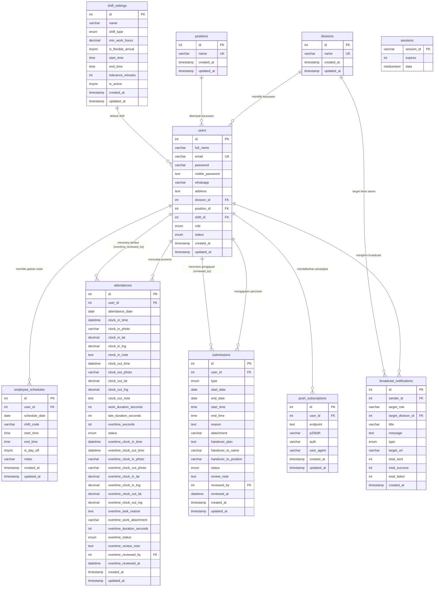

# 04. Desain Database As-Built

| Metadata | Keterangan |
| :--- | :--- |
| **Sistem** | SedayaClick — Sistem Presensi & Penggajian Karyawan PWA |
| **Basis Data** | MySQL 8.0 / MariaDB 10.4+ |
| **Encoding / Collation** | `utf8mb4` / `utf8mb4_unicode_ci` |
| **Versi Dokumen** | 1.0.0 (As-Built) |
| **Tanggal Analisis** | 23 November 2026 |
| **Sumber Analisis** | `config/schema.sql`, `sedayaclick.sql`, `config/db.js`, `server.js` |

---

## 1. Entity Relationship Diagram (ERD)

---

## 2. Kamus Data Sistem (Data Dictionary)

### 2.1 Tabel `users` (Pengguna Sistem)
[TERVERIFIKASI: config/schema.sql:234-263, config/db.js:64-72]
Menyimpan akun pengguna karyawan, admin manager, dan super admin.

| Nama Kolom | Tipe Data | Nullable | Default | Keterangan / Constraint |
| :--- | :--- | :---: | :--- | :--- |
| `id` | `INT(11)` | Tidak | *AUTO_INCREMENT* | Primary Key |
| `full_name` | `VARCHAR(100)` | Tidak | - | Nama lengkap resmi karyawan |
| `email` | `VARCHAR(100)` | Tidak | - | Alamat email unik (*Unique Key*) |
| `password` | `VARCHAR(255)` | Tidak | - | Kata sandi hash satu arah (Bcrypt salt 10) |
| `visible_password` | `TEXT` | Ya | `NULL` | Kata sandi terenkripsi dua arah (AES-256-CBC) |
| `whatsapp` | `VARCHAR(20)` | Ya | `NULL` | Nomor kontak WhatsApp aktif |
| `address` | `TEXT` | Ya | `NULL` | Alamat domisili tempat tinggal |
| `division_id` | `INT(11)` | Ya | `NULL` | Foreign Key ke `divisions.id` |
| `position_id` | `INT(11)` | Ya | `NULL` | Foreign Key ke `positions.id` |
| `shift_id` | `INT(11)` | Ya | `NULL` | Foreign Key ke `shift_settings.id` |
| `role` | `ENUM('employee','admin_manager','super_admin')` | Tidak | `'employee'` | Peran otorisasi RBAC sistem |
| `status` | `ENUM('pending','active','inactive')` | Tidak | `'pending'` | Status aktivasi akun pengguna |
| `created_at` | `TIMESTAMP` | Tidak | `CURRENT_TIMESTAMP` | Waktu registrasi akun |
| `updated_at` | `TIMESTAMP` | Tidak | `CURRENT_TIMESTAMP` | Waktu pembaruan profil terakhir |

### 2.2 Tabel `attendances` (Presensi Harian & Lembur Mandiri)
[TERVERIFIKASI: config/schema.sql:30-70, server.js:210-245]
Menyimpan transaksi harian Clock In, Clock Out, dan Presensi Lembur.

| Nama Kolom | Tipe Data | Nullable | Default | Keterangan / Constraint |
| :--- | :--- | :---: | :--- | :--- |
| `id` | `INT(11)` | Tidak | *AUTO_INCREMENT* | Primary Key |
| `user_id` | `INT(11)` | Tidak | - | Foreign Key ke `users.id` |
| `attendance_date` | `DATE` | Tidak | - | Tanggal absensi (Compound Unique: `user_id, attendance_date`) |
| `clock_in_time` | `DATETIME` | Ya | `NULL` | Waktu aktual Clock In |
| `clock_in_photo` | `VARCHAR(255)` | Ya | `NULL` | Path relatif berkas swafoto masuk (`/uploads/attendance/...`) |
| `clock_in_lat` | `DECIMAL(10,7)` | Ya | `NULL` | Koordinat latitude satelit saat masuk |
| `clock_in_lng` | `DECIMAL(10,7)` | Ya | `NULL` | Koordinat longitude satelit saat masuk |
| `clock_in_note` | `TEXT` | Ya | `NULL` | Catatan opsional karyawan saat masuk |
| `clock_out_time` | `DATETIME` | Ya | `NULL` | Waktu aktual Clock Out |
| `clock_out_photo`| `VARCHAR(255)` | Ya | `NULL` | Path relatif berkas swafoto pulang |
| `clock_out_lat` | `DECIMAL(10,7)` | Ya | `NULL` | Koordinat latitude satelit saat pulang |
| `clock_out_lng` | `DECIMAL(10,7)` | Ya | `NULL` | Koordinat longitude satelit saat pulang |
| `clock_out_note` | `TEXT` | Ya | `NULL` | Catatan karyawan saat pulang |
| `work_duration_seconds` | `INT(11)` | Ya | `NULL` | Durasi kerja total dalam hitungan detik |
| `late_duration_seconds` | `INT(11)` | Ya | `0` | Durasi keterlambatan dalam hitungan detik |
| `overtime_seconds` | `INT(11)` | Ya | `0` | Durasi kelebihan jam kerja shift (detik) |
| `status` | `ENUM('on_time','late','early_leave','incomplete')` | Tidak | `'incomplete'` | Status pemenuhan kehadiran |
| `overtime_clock_in_time` | `DATETIME` | Ya | `NULL` | Waktu masuk lembur mandiri |
| `overtime_clock_out_time`| `DATETIME` | Ya | `NULL` | Waktu keluar lembur mandiri |
| `overtime_clock_in_photo`| `VARCHAR(255)` | Ya | `NULL` | Foto swafoto saat masuk lembur |
| `overtime_clock_out_photo`| `VARCHAR(255)`| Ya | `NULL` | Foto swafoto saat keluar lembur |
| `overtime_clock_in_lat` | `DECIMAL(10,7)`| Ya | `NULL` | Lokasi GPS latitude lembur masuk |
| `overtime_clock_in_lng` | `DECIMAL(10,7)`| Ya | `NULL` | Lokasi GPS longitude lembur masuk |
| `overtime_clock_out_lat` | `DECIMAL(10,7)`| Ya | `NULL` | Lokasi GPS latitude lembur keluar |
| `overtime_clock_out_lng` | `DECIMAL(10,7)`| Ya | `NULL` | Lokasi GPS longitude lembur keluar |
| `overtime_task_reason` | `TEXT` | Ya | `NULL` | Uraian penugasan pekerjaan lembur |
| `overtime_work_attachment`| `VARCHAR(255)`| Ya | `NULL` | Path bukti berkas hasil pekerjaan lembur |
| `overtime_duration_seconds`| `INT(11)` | Ya | `0` | Durasi lembur mandiri dalam detik |
| `overtime_status` | `ENUM('pending','under_review','approved','rejected')` | Ya | `'pending'` | Status persetujuan lembur |
| `overtime_review_note` | `TEXT` | Ya | `NULL` | Catatan manajer saat review lembur |
| `overtime_reviewed_by` | `INT(11)` | Ya | `NULL` | ID User manajer peninjau lembur |
| `overtime_reviewed_at` | `DATETIME` | Ya | `NULL` | Waktu persetujuan lembur diberikan |
| `created_at` | `TIMESTAMP` | Tidak | `CURRENT_TIMESTAMP` | Waktu baris dibuat |
| `updated_at` | `TIMESTAMP` | Tidak | `CURRENT_TIMESTAMP` | Waktu baris diperbarui otomatis |

### 2.3 Tabel `submissions` (Pengajuan Izin, Cuti, Sakit, Lembur Form)
[TERVERIFIKASI: config/schema.sql:170-205, config/db.js:46-62, server.js:145-155]

| Nama Kolom | Tipe Data | Nullable | Default | Keterangan / Constraint |
| :--- | :--- | :---: | :--- | :--- |
| `id` | `INT(11)` | Tidak | *AUTO_INCREMENT* | Primary Key |
| `user_id` | `INT(11)` | Tidak | - | Foreign Key ke `users.id` |
| `type` | `ENUM('izin','cuti','sakit','lembur')` | Tidak | - | Jenis pengajuan |
| `start_date` | `DATE` | Tidak | - | Tanggal mulai izin/cuti |
| `end_date` | `DATE` | Tidak | - | Tanggal akhir izin/cuti |
| `start_time` | `TIME` | Ya | `NULL` | Jam mulai lembur (khusus tipe lembur) |
| `end_time` | `TIME` | Ya | `NULL` | Jam selesai lembur (khusus tipe lembur) |
| `reason` | `TEXT` | Tidak | - | Alasan lengkap pengajuan |
| `attachment` | `VARCHAR(255)` | Ya | `NULL` | Path berkas surat dokter / dokumen pendukung |
| `handover_plan` | `TEXT` | Ya | `NULL` | Rencana serah terima pekerjaan (khusus cuti) |
| `handover_to_name` | `VARCHAR(255)` | Ya | `NULL` | Nama rekan kerja penerima serah terima |
| `handover_to_position` | `VARCHAR(255)` | Ya | `NULL` | Jabatan rekan penerima serah terima |
| `status` | `ENUM('pending','under_review','approved','rejected')` | Tidak | `'pending'` | Status persetujuan pengajuan |
| `review_note` | `TEXT` | Ya | `NULL` | Catatan peninjau saat memberi keputusan |
| `reviewed_by` | `INT(11)` | Ya | `NULL` | ID User peninjau (Foreign Key ke `users.id`) |
| `reviewed_at` | `DATETIME` | Ya | `NULL` | Waktu keputusan diambil |
| `created_at` | `TIMESTAMP` | Tidak | `CURRENT_TIMESTAMP` | Waktu pengajuan diajukan |
| `updated_at` | `TIMESTAMP` | Tidak | `CURRENT_TIMESTAMP` | Waktu status pengajuan diperbarui |

### 2.4 Tabel `employee_schedules` (Jadwal Roster & Libur Rolling)
[TERVERIFIKASI: server.js:250-265, config/db.js:148-165]

| Nama Kolom | Tipe Data | Nullable | Default | Keterangan / Constraint |
| :--- | :--- | :---: | :--- | :--- |
| `id` | `INT` | Tidak | *AUTO_INCREMENT* | Primary Key |
| `user_id` | `INT` | Tidak | - | Foreign Key ke `users.id` (Index: `idx_user_id`) |
| `schedule_date` | `DATE` | Tidak | - | Tanggal shift (Index: `idx_schedule_date`) |
| `shift_code` | `VARCHAR(20)` | Tidak | - | Kode shift (P, S, VK, VW, VH, R, PL, SAT, L, OFF) |
| `start_time` | `TIME` | Ya | `NULL` | Jam mulai shift |
| `end_time` | `TIME` | Ya | `NULL` | Jam berakhir shift |
| `is_day_off` | `TINYINT(1)` | Tidak | `0` | Flag libur terjadwal (1 = Libur, 0 = Kerja) |
| `notes` | `VARCHAR(255)` | Ya | `NULL` | Keterangan khusus jadwal |
| `created_at` | `TIMESTAMP` | Tidak | `CURRENT_TIMESTAMP` | Waktu penugasan dibuat |
| `updated_at` | `TIMESTAMP` | Tidak | `CURRENT_TIMESTAMP` | Waktu penugasan diperbarui |
| **Constraint** | `UNIQUE KEY` | - | - | `unique_user_date (user_id, schedule_date)` |

### 2.5 Tabel `shift_settings` (Pengaturan Jam Kerja / Master Shift)
[TERVERIFIKASI: config/schema.sql:140-165, server.js:163-176]

| Nama Kolom | Tipe Data | Nullable | Default | Keterangan |
| :--- | :--- | :---: | :--- | :--- |
| `id` | `INT(11)` | Tidak | *AUTO_INCREMENT* | Primary Key |
| `name` | `VARCHAR(100)` | Tidak | - | Nama shift (misal: "Shift Reguler", "Shift Khusus") |
| `shift_type` | `ENUM('fixed','flexible_hours','roster')` | Tidak | `'fixed'` | Klasifikasi aturan kedatangan |
| `min_work_hours` | `DECIMAL(4,2)` | Tidak | `9.00` | Target jam kerja per hari (jam) |
| `is_flexible_arrival` | `TINYINT(1)` | Tidak | `0` | 1 jika jam kedatangan bebas keterlambatan |
| `start_time` | `TIME` | Tidak | `'08:00:00'` | Jam masuk standar |
| `end_time` | `TIME` | Tidak | `'17:00:00'` | Jam pulang standar |
| `tolerance_minutes` | `INT(11)` | Tidak | `0` | Toleransi keterlambatan dalam menit |
| `is_active` | `TINYINT(1)` | Tidak | `1` | Status keaktifan shift |
| `created_at` | `TIMESTAMP` | Tidak | `CURRENT_TIMESTAMP` | Waktu dibuat |
| `updated_at` | `TIMESTAMP` | Tidak | `CURRENT_TIMESTAMP` | Waktu diperbarui |

### 2.6 Tabel `divisions` & `positions` (Master Organisasi)
[TERVERIFIKASI: config/schema.sql:81-125]
- `divisions`: `id` (PK, INT Auto), `name` (VARCHAR 100, UNIQUE), `created_at`, `updated_at`.
- `positions`: `id` (PK, INT Auto), `name` (VARCHAR 100, UNIQUE), `created_at`, `updated_at`.

### 2.7 Tabel `push_subscriptions` & `broadcast_notifications` (Notifikasi)
[TERVERIFIKASI: config/db.js:169-200]
- `push_subscriptions`: `id` (PK), `user_id` (INT), `endpoint` (TEXT, Unique prefix 191), `p256dh` (VARCHAR 255), `auth` (VARCHAR 255), `user_agent` (VARCHAR 255), `created_at`, `updated_at`.
- `broadcast_notifications`: `id` (PK), `sender_id` (INT), `target_role` (VARCHAR 50), `target_division_id` (INT NULL), `title` (VARCHAR 255), `message` (TEXT), `type` (ENUM 'info','warning','urgent'), `target_url` (VARCHAR 255), `total_sent` (INT), `total_success` (INT), `total_failed` (INT), `created_at`.

### 2.8 Tabel `sessions` (Session Store)
[TERVERIFIKASI: config/schema.sql:128-136, server.js:76]
- `session_id`: `VARCHAR(128)` (Primary Key).
- `expires`: `INT(11) UNSIGNED` (Timestamp kadaluarsa sesi).
- `data`: `MEDIUMTEXT` (JSON serialisasi objek sesi Express, mencakup user ID, peran, email, nama).

---

## 3. Relasi Antar Tabel & Aturan Hapus (Integrity & Cascade Rules)

Berdasarkan implementasi kode pada router administratif [TERVERIFIKASI: routes/superadmin.js:203-221]:
1. **Penghapusan User (`DELETE /api/superadmin/users/:id`)**:
   Karena constraint foreign key dipertahankan secara ketat di MySQL, penghapusan akun dilakukan secara prosedural terurut:
   - Langkah 1: `DELETE FROM attendances WHERE user_id = ?`
   - Langkah 2: `DELETE FROM submissions WHERE user_id = ?`
   - Langkah 3: `DELETE FROM users WHERE id = ?`
2. **Keterkaitan Data Master**:
   Tabel `divisions`, `positions`, dan `shift_settings` terhubung ke `users` melalui kolom nullable (`division_id`, `position_id`, `shift_id`). Penghapusan master yang sedang dirujuk oleh pengguna aktif ditolak oleh foreign key RESTRICT bawaan engine InnoDB.

---

## 4. Tabel yang Menyimpan Data Pribadi (PII)

Sesuai ketentuan **UU No. 27 Tahun 2022 tentang Pelindungan Data Pribadi (UU PDP)**, tabel-tabel berikut mengelola data pribadi sensitif karyawan:

| Nama Tabel | Kolom Berisi PII | Kategori Data Pribadi | Sensitivitas |
| :--- | :--- | :--- | :---: |
| `users` | `full_name`, `email`, `whatsapp`, `address` | Identitas umum, kontak, dan alamat tempat tinggal | **Tinggi** |
| `users` | `password` (hash), `visible_password` (AES cipher) | Kredensial keamanan otentikasi akun | **Sangat Tinggi** |
| `attendances` | `clock_in_photo`, `clock_out_photo`, `overtime_*_photo` | Data biometrik visual (swafoto wajah karyawan) | **Sangat Tinggi** |
| `attendances` | `clock_in_lat/lng`, `clock_out_lat/lng`, `overtime_*_lat/lng` | Data lokasi presisi satelit (Geolocation real-time) | **Tinggi** |
| `submissions` | `reason`, `attachment` (surat dokter / rekam medis) | Data riwayat kesehatan & kondisi medis karyawan | **Sangat Tinggi** |
| `push_subscriptions`| `endpoint`, `user_agent` | Data pengenal perangkat fisik & browser pengguna | **Sedang** |

---

## 5. Estimasi Pertumbuhan Data & Kebijakan Retensi

### 5.1 Estimasi Volume Pertumbuhan Data (Per 100 Karyawan Aktif)
[ASUMSI: rata-rata 22 hari kerja per bulan, 10% lembur, 5% pengajuan izin]

| Komponen Penyimpanan | Estimasi Harian | Estimasi Bulanan (x22 hari) | Estimasi Tahunan |
| :--- | :---: | :---: | :---: |
| **Baris `attendances`** | 100 baris | ~2.200 baris | ~26.400 baris (~10 MB) |
| **Berkas Foto Masuk & Pulang** (Rata-rata 250 KB per foto x 2) | 50 MB / hari | ~1,1 GB / bulan | ~13,2 GB / tahun |
| **Baris `submissions`** | ~5 baris / hari | ~110 baris / bulan | ~1.320 baris (~1 MB) |
| **Lampiran Pengajuan** (Rata-rata 1 MB) | ~3 MB / hari | ~66 MB / bulan | ~800 MB / tahun |
| **Total Pertumbuhan Storage** | ~55 MB / hari | **~1,2 GB / bulan** | **~14 GB / tahun** |

### 5.2 Kebijakan Retensi & Pencadangan (*Backup & Retention Policy*)
[TERVERIFIKASI: services/telegramBot.js:47-73, deploy/setup-vps.sh:160-185]
1. **Pencadangan Basis Data**:
   - Skrip maintenance `services/telegramBot.js` menyediakan perintah on-demand `/backup_db` yang mengeksekusi `mysqldump` terkompresi `gzip` (`sedayaclick_db_*.sql.gz`) dan langsung dikirimkan ke Telegram Administrator.
2. **Pencadangan Berkas Media**:
   - Perintah `/backup_photos` membuat arsip `tar.gz` direktori `uploads/` untuk diunduh secara berkala.
3. **Pembersihan Data Lama (*Data Purging*)**:
   - Perintah `/purge_old_data <days>` memfasilitasi pembersihan riwayat absensi dan penghapusan fisik file swafoto yang berusia lebih dari `N` hari guna mencegah kepenuhan disk VPS.
