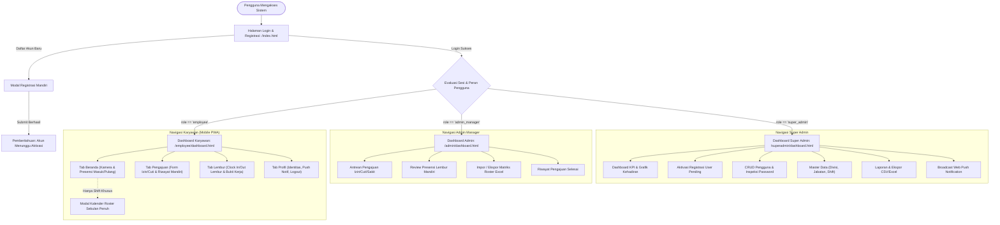

# 06. Antarmuka Pengguna (UI/UX) As-Built

| Metadata | Keterangan |
| :--- | :--- |
| **Sistem** | SedayaClick — Sistem Presensi & Penggajian Karyawan PWA |
| **Pendekatan Desain** | Mobile-First Progressive Web App (PWA) |
| **Framework CSS** | Tailwind CSS (CDN Play) |
| **Versi Dokumen** | 1.0.0 (As-Built) |
| **Tanggal Analisis** | 23 November 2026 |
| **Sumber Analisis** | Berkas HTML & JavaScript pada direktori `public/` |

---

## 1. Inventaris Halaman, Layar & Komponen UI

Sistem memiliki 4 antarmuka utama yang dirancang responsif untuk smartphone, tablet, dan desktop:

### 1.1 Halaman Autentikasi (`public/index.html` & `public/js/auth-page.js`)
- **Tujuan**: Pintu masuk utama sistem (Landing page, Login, dan Modal Pendaftaran Mandiri).
- **Komponen Utama**:
  - Kartu Glassmorphic Login dengan input email dan kata sandi.
  - Tombol aksi "Masuk ke Sistem" dengan indikator loading state.
  - Tombol pemicu pop-up modal "Daftar Akun Karyawan Baru".
  - Modal registrasi mandiri: Nama Lengkap, Email, Password, Dropdown Dinamis Divisi & Jabatan (diambil via `GET /api/auth/meta`), Nomor WhatsApp, dan Alamat Lengkap.
  - Banner PWA install prompt dan splash screen loader.

### 1.2 Dashboard Karyawan (`public/employee/dashboard.html` & `public/employee/js/employee.js`)
- **Tujuan**: Antarmuka operasional harian karyawan berbasis smartphone (*mobile viewport 420px - 600px*).
- **Komponen Utama**:
  - **Header Profil**: Nama karyawan, divisi, jabatan, status keaktifan (*badge* hijau berdenyut), dan tombol Logout.
  - **Banner Jam Server Digital**: Tampilan jam WIB real-time yang tersinkronisasi presisi (`HH.mm.ss WIB`) dengan tanggal bahasa Indonesia.
  - **Widget Status Kehadiran**: Kartu ringkasan Clock In, Clock Out, dan badge kehadiran (`Belum Absen`, `Sudah Clock In`, `Terlambat`, `Absensi Selesai`).
  - **Komponen Kamera WebRTC Viewfinder**: Area kamera rasio 1:1 dengan tombol switch kamera depan/belakang, pill indikator lock GPS satelit, catatan kehadiran, dan tombol pemicu capture.
  - **Widget Jadwal Roster Shift Hari Ini** (`#roster-schedule-banner`):
    - *Aturan Visibilitas*: Tersembunyi secara default; hanya muncul bagi karyawan yang terdaftar pada Shift Khusus / Roster. Menampilkan kode shift (Pagi, Siang, SSV, Libur Rolling) dan tombol kalender.
  - **Kartu Pintasan Kalender Roster** (`#roster-quick-shortcut`):
    - Pintasan cepat untuk membuka modal kalender roster sebulan penuh (hanya muncul bagi karyawan shift khusus).
  - **Modal Kalender Roster Sebulan Penuh** (`#modal-my-roster`):
    - Kalender interaktif dengan seleksi bulan (YYYY-MM), badge warna-warni tiap shift (P: Hijau, S: Kuning, SSV: Biru, L/OFF: Merah), dan profil shift kerja.
  - **Bottom Navigation Bar**: Navigasi bawah melayang (*floating bottom bar*) dengan 4 tab:
    1. *Beranda* (Presensi harian & kamera)
    2. *Pengajuan* (Formulir pengajuan izin/cuti/sakit & riwayat mandiri)
    3. *Lembur* (Presensi lembur mandiri masuk/pulang & bukti kerja)
    4. *Profil* (Informasi identitas akun & pengaturan notifikasi Web Push)

### 1.3 Dashboard Admin Manager (`public/admin/dashboard.html` & `public/admin/js/admin.js`)
- **Tujuan**: Antarmuka manajemen menengah untuk peninjauan izin/cuti dan impor roster.
- **Komponen Utama**:
  - **Header Navigasi & Filter Divisi**: Dropdown filter divisi untuk menyaring data tim.
  - **Statistik Cepat Antrean**: Counter jumlah pengajuan pending, pengajuan ditinjau, dan presensi lembur.
  - **Tab Antrean Pengajuan Pending**: Tabel antrean dengan aksi cepat *Setujui*, *Tolak*, *Tandai Ditinjau*, dan tombol lihat lampiran bukti.
  - **Tab Presensi Lembur Langsung**: Daftar presensi lembur mandiri karyawan lengkap dengan swafoto, titik lokasi, dan dokumen hasil kerja.
  - **Tab Manajemen Roster**: Tombol unduh template Excel, tombol ekspor matriks, dan form drag-and-drop unggah file jadwal roster bulanan.
  - **Modal Keputusan Pengajuan**: Formulir popup untuk memberikan catatan keputusan peninjau (*review note*).
  - **Tombol Pengingat Email Manajer**: Tombol manual untuk mengirim email pengingat rekapitulasi antrean pending ke inbox manajer.

### 1.4 Dashboard Super Admin (`public/superadmin/dashboard.html` & `public/superadmin/js/superadmin.js`)
- **Tujuan**: Antarmuka kendali eksekutif dan administrasi organisasi.
- **Komponen Utama**:
  - **Sidebar Navigasi**: Dashboard Utama, Persetujuan User, Manajemen Pengguna, Master Divisi, Master Jabatan, Master Shift, Rekap Laporan, dan Broadcast Notifikasi.
  - **Metrik KPI Utama (Gaya Mekari Talenta)**: Kartu ringkasan Hadir Tepat Waktu, Terlambat, Pengajuan Pending, Karyawan Aktif, Izin, Sakit, Cuti, dan Lembur.
  - **Grafik Tren Kehadiran**: Grafik garis (*Line Chart*) interaktif pergerakan kehadiran harian vs keterlambatan.
  - **Tabel Verifikasi Pengguna Pending**: Daftar pendaftaran mandiri baru dengan tombol aksi satu klik *Aktifkan Akun* atau *Tolak*.
  - **Tabel Manajemen User & Kata Sandi**: Fitur pencarian, edit profil, hapus akun, dan ikon intip (*show/hide*) kata sandi asli karyawan yang didekripsi secara aman.
  - **Modul Master Shift**: Form konfigurasi jam masuk, jam pulang, toleransi menit, dan switch tipe shift (*Fixed*, *Flexible*, *Roster*).
  - **Modul Ekspor Laporan**: Filter tanggal kustom, divisi, dan tombol unduh instan berkas CSV dan Excel.

---

## 2. Diagram Peta Navigasi Antarmuka (Mermaid)

---

## 3. Pemetaan Layar -> Endpoint API -> Tabel Database

| Layar / Halaman UI | Komponen Aksi | Endpoint API yang Dipanggil | Tabel Database Terkait |
| :--- | :--- | :--- | :--- |
| **Login (`index.html`)** | Buka halaman | `GET /api/auth/meta` | `divisions`, `positions` |
| | Submit Login | `POST /api/auth/login` | `users`, `sessions` |
| | Submit Pendaftaran | `POST /api/auth/register` | `users` |
| **Dashboard Karyawan** | Buka Beranda | `GET /api/attendance/today` `GET /api/auth/me` | `attendances`, `employee_schedules`, `shift_settings`, `users` |
| | Clock In Harian | `POST /api/attendance/clock-in` | `attendances` |
| | Clock Out Harian | `POST /api/attendance/clock-out` | `attendances` |
| | Buka Kalender Roster | `GET /api/attendance/my-roster` | `employee_schedules` |
| | Kirim Pengajuan | `POST /api/submissions` | `submissions` |
| | Riwayat Pengajuan | `GET /api/submissions/mine` | `submissions` |
| | Clock In Lembur | `POST /api/attendance/overtime/clock-in` | `attendances` |
| | Clock Out Lembur | `POST /api/attendance/overtime/clock-out` | `attendances` |
| | Aktifkan Push Notif | `POST /api/notifications/subscribe` | `push_subscriptions` |
| **Dashboard Admin** | Buka Antrean | `GET /api/admin/submissions/pending` | `submissions`, `users`, `divisions` |
| | Setujui / Tolak Form | `PATCH /api/admin/submissions/:id/decision` | `submissions` |
| | Buka Antrean Lembur | `GET /api/admin/overtime/pending` | `attendances`, `users` |
| | Keputusan Lembur | `PATCH /api/admin/overtime/:id/decision` | `attendances` |
| | Unduh Roster Template| `GET /api/admin/roster/template` | `users`, `shift_settings` |
| | Unggah Roster Excel | `POST /api/admin/roster/upload` | `employee_schedules` |
| | Kirim Pengingat Email| `POST /api/admin/notifications/remind-manager` | `submissions`, `attendances` |
| **Dashboard Super Admin**| Buka Ringkasan KPI | `GET /api/superadmin/dashboard/summary` | `attendances`, `submissions`, `users` |
| | Aktivasi User Pending| `PATCH /api/superadmin/users/:id/status` | `users` |
| | CRUD & Edit User | `GET /api/superadmin/users` `POST/PUT/DELETE /api/superadmin/users/:id` | `users`, `attendances`, `submissions` |
| | Master Divisi/Jabatan | `GET/POST/PUT/DELETE /api/superadmin/divisions` `GET/POST/PUT/DELETE /api/superadmin/positions` | `divisions`, `positions` |
| | Master Shift | `GET/POST/PUT/DELETE /api/superadmin/shifts` | `shift_settings` |
| | Ekspor Laporan | `GET /api/reports/export/excel` `GET /api/reports/export/csv` | `attendances`, `users`, `divisions` |
| | Kirim Broadcast | `POST /api/notifications/broadcast` | `broadcast_notifications`, `push_subscriptions` |
