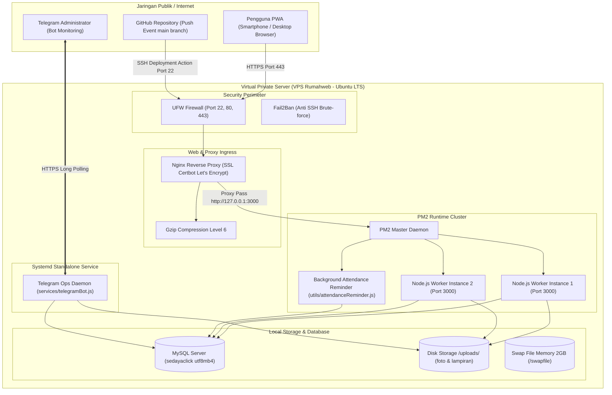

# 09. Panduan Deployment dan Operasi (Runbook) As-Built

| Metadata | Keterangan |
| :--- | :--- |
| **Sistem** | SedayaClick — Sistem Presensi & Penggajian Karyawan PWA |
| **Target Lingkungan** | Production Virtual Private Server (VPS) |
| **Sistem Operasi** | Ubuntu 20.04 / 22.04 LTS (x86_64) |
| **Versi Dokumen** | 1.0.0 (As-Built) |
| **Tanggal Analisis** | 23 November 2026 |
| **Sumber Analisis** | `deploy/setup-vps.sh`, `deploy/nginx-sedayaclick.conf`, `ecosystem.config.js`, `.github/workflows/deploy.yml` |

---

## 1. Topologi Arsitektur Infrastruktur

Sistem SedayaClick di-hosting secara mandiri pada infrastruktur Virtual Private Server (VPS) Bare-OS:



---

## 2. Spesifikasi Lingkungan Produksi

| Komponen Infrastruktur | Spesifikasi Teknis | Rujukan Berkas |
| :--- | :--- | :--- |
| **Hosting Server** | VPS Rumahweb Cloud / Dedicated Virtual Instance | [TERVERIFIKASI: deploy/setup-vps.sh:16] |
| **Sistem Operasi** | Ubuntu Linux 20.04.6 LTS / 22.04 LTS | [TERVERIFIKASI: deploy/setup-vps.sh:4] |
| **Kapasitas Swap** | 2 GB Swapfile (`/swapfile`) untuk stabilitas RAM | [TERVERIFIKASI: deploy/setup-vps.sh:35-44] |
| **Node.js Runtime** | Node.js v20.x LTS | [TERVERIFIKASI: deploy/setup-vps.sh:54] |
| **Process Manager** | PM2 v5+ (Cluster Mode: `max` instances) | [TERVERIFIKASI: ecosystem.config.js:6-7] |
| **Web Server Proxy** | Nginx dengan Let's Encrypt SSL/TLS & Gzip | [TERVERIFIKASI: deploy/nginx-sedayaclick.conf] |
| **Database Server** | MySQL Server 8.0 / MariaDB 10.4+ (Default port: `3306`) | [TERVERIFIKASI: deploy/setup-vps.sh:59-67] |
| **Domain Resmi** | `sedayaclick.cloud` (dan `www.sedayaclick.cloud`) | [TERVERIFIKASI: deploy/setup-vps.sh:24] |
| **Timezone Server** | `Asia/Jakarta` (Waktu Indonesia Barat / UTC+7) | [TERVERIFIKASI: deploy/setup-vps.sh:51] |

---

## 3. Prosedur Deployment Langkah demi Langkah

### 3.1 Otomasi CI/CD via GitHub Actions
Sistem dilengkapi pipeline otomatisasi deployment [TERVERIFIKASI: .github/workflows/deploy.yml]. Setiap kali developer melakukan `git push origin main`, GitHub Actions mengeksekusi tahapan:
1. Menghubungkan ke VPS melalui protokol SSH terenkripsi (`appleboy/ssh-action@v1.0.3`).
2. Masuk ke direktori aplikasi: `cd /var/www/sedayaclick`.
3. Menarik kode terbaru: `git fetch origin main && git reset --hard origin/main`.
4. Menginstal dependensi produksi: `npm install --production`.
5. Melakukan reload proses PM2 tanpa downtime: `pm2 reload ecosystem.config.js --env production || pm2 start ecosystem.config.js --env production`.
6. Menyimpan status proses: `pm2 save`.

### 3.2 Prosedur Deployment Manual di VPS (Bila CI/CD Tidak Digunakan)
Jika diperlukan intervensi manual langsung melalui terminal SSH root VPS:

```bash
# 1. Masuk ke server melalui SSH
ssh root@202.10.34.212

# 2. Masuk ke direktori kerja aplikasi
cd /var/www/sedayaclick

# 3. Ambil perubahan kode terbaru dari remote git
git fetch origin main
git reset --hard origin/main

# 4. Pastikan kepemilikan dan hak akses direktori upload
mkdir -p uploads/attendance uploads/submissions
chmod -R 755 uploads

# 5. Instal dependensi jika ada penambahan paket baru di package.json
npm install --production

# 6. Muat ulang server menggunakan PM2 (Zero Downtime)
pm2 reload sedayaclick

# 7. Verifikasi log server berjalan normal
pm2 logs sedayaclick --lines 30 --nostream
```

---

## 4. Konfigurasi Variabel Lingkungan (.env)

Variabel lingkungan berikut wajib didefinisikan pada berkas `/var/www/sedayaclick/.env` pada VPS produksi (tanpa membocorkan nilai rahasia):

```ini
PORT=3000
NODE_ENV=production
SESSION_SECRET=[String acak heksadesimal 64 karakter]
ALLOWED_ORIGIN=https://sedayaclick.cloud,https://www.sedayaclick.cloud

DB_HOST=127.0.0.1
DB_PORT=3306
DB_USER=sedaya_user
DB_PASSWORD=[Password database terisolasi]
DB_NAME=sedayaclick

OFFICE_LATITUDE=-6.597147
OFFICE_LONGITUDE=106.806038
OFFICE_RADIUS_METERS=150

VAPID_PUBLIC_KEY=[Kunci publik VAPID Web Push]
VAPID_PRIVATE_KEY=[Kunci privat VAPID Web Push]
VAPID_SUBJECT=mailto:admin@sedayaclick.cloud

SMTP_HOST=smtp.gmail.com
SMTP_PORT=465
SMTP_SECURE=true
SMTP_USER=[Email akun SMTP resmi]
SMTP_PASS=[App Password Gmail 16 digit]
EMAIL_FROM_NAME="SedayaClick System"
EMAIL_FROM_ADDRESS=[Email akun SMTP resmi]
APP_BASE_URL=https://sedayaclick.cloud
FALLBACK_MANAGER_EMAIL=[Email manajer divisi penerima antrean]

TELEGRAM_BOT_TOKEN=[Token BotFather Bot Telegram]
TELEGRAM_ADMIN_CHAT_ID=[ID Telegram Administrator]
```

---

## 5. Background Jobs, Cron, dan Daemon

1. **Attendance Reminder Scheduler**:
   - Dijalankan secara otomatis saat server HTTP listen [TERVERIFIKASI: server.js:276].
   - Frekuensi: Interval loop setiap 60 detik (`setInterval`).
   - Tugas: Memeriksa karyawan yang jadwal shiftnya dimulai dalam 15 menit ke depan atau berakhir dalam 15 menit ke depan, lalu menembak Web Push Notification.
2. **SedayaClick Telegram Ops & Maintenance Daemon**:
   - Berkas: [TERVERIFIKASI: services/telegramBot.js].
   - Dikelola oleh PM2 sebagai proses independen:
     ```bash
     pm2 start services/telegramBot.js --name sedayaclick-bot
     pm2 save
     ```
   - Tugas: Long-polling Telegram Bot API untuk menerima perintah diagnostik `/status`, `/backup_db`, `/backup_photos`, `/restart_server`, `/purge_old_data`.

---

## 6. Prosedur Pencadangan (Backup) dan Pemulihan (Restore)

### 6.1 Prosedur Backup Basis Data
1. **Cara Cepat (Remote via Telegram Bot)**:
   - Buka percakapan dengan `@SedayaClickOps_bot` di aplikasi Telegram.
   - Ketik perintah: `/backup_db`.
   - Bot akan memicu `mysqldump` terkompresi dan mengirimkan file `sedayaclick_db_YYYY-MM-DD_HHmmss.sql.gz` ke chat Telegram.
2. **Cara Manual (CLI Terminal)**:
   ```bash
   mysqldump -u sedaya_user -p sedayaclick | gzip > /root/backups/sedayaclick_$(date +%Y%m%d_%H%M%S).sql.gz
   ```

### 6.2 Prosedur Pemulihan (Restore) Basis Data
Jika terjadi insiden kehilangan data atau kegagalan transaksi:

```bash
# 1. Hentikan aplikasi sementara untuk mencegah penulisan data baru
pm2 stop sedayaclick

# 2. Ekstrak dan import file backup SQL ke MySQL
gunzip < /root/backups/sedayaclick_YYYYMMDD_HHMMSS.sql.gz | mysql -u sedaya_user -p sedayaclick

# 3. Nyalakan kembali aplikasi
pm2 restart sedayaclick

# 4. Verifikasi log aplikasi
pm2 logs sedayaclick --lines 20 --nostream
```

---

## 7. Pemantauan (Monitoring) & Penanganan Insiden (Troubleshooting)

### 7.1 Perintah Diagnostik Rutin
```bash
# Cek utilisasi CPU dan Memory seluruh instance
pm2 monit

# Cek 50 baris log error terakhir
pm2 logs sedayaclick --err --lines 50 --nostream

# Cek status server web Nginx
systemctl status nginx

# Cek status service MySQL
systemctl status mysql

# Cek ruang disk penyimpanan
df -h
```

### 7.2 Prosedur Penanganan Insiden Umum

| Skenario Insiden | Gejala / Pesan Error | Prosedur Penanganan Langkah demi Langkah |
| :--- | :--- | :--- |
| **1. Error Bad Null Constraint Saat Clock Out** | `ER_BAD_NULL_ERROR: Column 'status' cannot be null` | 1. Buka `routes/attendance.js:275-285`.<br>2. Pastikan variabel `status` tidak pernah `undefined` sebelum query SQL UPDATE.<br>3. Gunakan fallback `status = status \|\| 'on_time'` dan restart PM2. |
| **2. Disk VPS Penuh (100% Usage)** | `ENOSPC: no space left on device` / Nginx 500 | 1. Cek folder upload: `du -sh /var/www/sedayaclick/uploads/*`.<br>2. Bersihkan file log PM2: `pm2 flush`.<br>3. Gunakan perintah bot Telegram `/purge_old_data 90` untuk menghapus foto swafoto berusia > 90 hari. |
| **3. Node.js Memory Leak / OOM Crash** | PM2 restart count bertambah cepat, `status: errored` | 1. Periksa `ecosystem.config.js` dan tambahkan batasan `max_memory_restart: '500M'`.<br>2. Restart PM2: `pm2 reload ecosystem.config.js`.<br>3. Periksa query laporan besar di `routes/reports.js` agar menggunakan stream/pagination. |
| **4. Kesalahan Rilis Kode (Rollback Segera)** | Sistem error setelah `git pull` terbaru | 1. Cari commit stabil sebelumnya: `git log --oneline -n 5`.<br>2. Lakukan hard rollback: `git reset --hard <commit-hash-stabil>`.<br>3. Muat ulang aplikasi: `pm2 reload sedayaclick`. |

---

## 8. Daftar Periksa Kesiapan Operasional (Go-Live Checklist)

- [ ] Seluruh tabel database dan auto-migration terpasang lengkap (`users`, `attendances`, `submissions`, `employee_schedules`, `push_subscriptions`).
- [ ] Akun Super Admin pertama telah dibuat dengan status `active`.
- [ ] Sertifikat SSL Let's Encrypt aktif dan terpasang di Nginx (`https://sedayaclick.cloud`).
- [ ] Domain whitelist `ALLOWED_ORIGIN` terkonfigurasi dengan benar di `.env`.
- [ ] VAPID Keys untuk Web Push Notification telah dihasilkan dan diuji coba melalui menu `/test`.
- [ ] Kredensial SMTP Gmail diuji coba berhasil mengirim email pengingat.
- [ ] Bot Telegram terhubung dan merespons perintah `/status` dari ID admin yang sah.
- [ ] PM2 dikonfigurasi untuk start otomatis saat server boot (`pm2 startup && pm2 save`).
- [ ] File konfigurasi swap memory 2GB aktif untuk mencegah out-of-memory crash.
