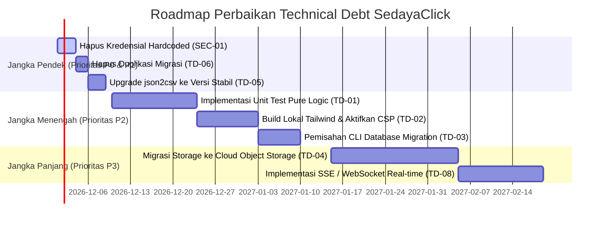

# 10. Pemeliharaan dan Register Technical Debt (Utang Teknis) As-Built

| Metadata | Keterangan |
| :--- | :--- |
| **Sistem** | SedayaClick — Sistem Presensi & Penggajian Karyawan PWA |
| **Versi Dokumen** | 1.0.0 (As-Built) |
| **Tanggal Analisis** | 23 November 2026 |
| **Sumber Analisis** | Kode implementasi, dependensi `package.json`, konfigurasi infrastruktur |

---

## 1. Register Utang Teknis (Technical Debt Register / TD-xx)

Analisis kode as-built mengidentifikasi sejumlah utang teknis yang perlu diperhatikan oleh tim pengembang dan arsitek sistem demi menjaga skalabilitas, stabilitas, dan keamanan jangka panjang:

| ID Utang | Judul Masalah & Lokasi | Tingkat Keparahan | Estimasi Usaha | Dampak Bisnis & Arsitektur | Rekomendasi Solusi Teknis |
| :--- | :--- | :---: | :---: | :--- | :--- |
| **TD-01** | **Ketiadaan Automated Test Suites** `[TERVERIFIKASI: package.json]` | **Tinggi (High)** | **M** *(2-3 minggu)* | Setiap penambahan fitur atau perbaikan bug (seperti kalkulasi roster/lembur) berisiko memicu regresi fungsi lain tanpa terdeteksi sebelum rilis ke VPS. | Pasang framework `jest` & `supertest`. Buat regression test suite untuk logika matematis `timeCalc.js`, parser roster, dan otorisasi middleware. |
| **TD-02** | **Tailwind CSS via Play CDN di Production** `[TERVERIFIKASI: public/index.html:10, server.js:38]` | **Sedang (Medium)** | **M** *(1-2 minggu)* | Memuat Tailwind CDN (`https://cdn.tailwindcss.com`) di production menyebabkan: (1) Header CSP Helmet dinonaktifkan (`contentSecurityPolicy: false`), (2) Performa render bergantung pada CDN pihak ketiga. | Bangun pipeline build CSS lokal (menggunakan Tailwind CLI / PostCSS / Vite). Compile CSS menjadi berkas statis lokal (`public/css/bundle.css`) dan aktifkan kembali CSP Helmet. |
| **TD-03** | **Runtime Auto-Migration pada Startup Server** `[TERVERIFIKASI: server.js:143-271, config/db.js:45-200]` | **Sedang (Medium)** | **M** *(1 minggu)* | Server menjalankan serangkaian `SHOW COLUMNS` dan `ALTER TABLE` setiap kali proses Node.js dinyalakan. Jika dijalankan di PM2 cluster (misal 4 worker), terjadi perebutan lock DDL tabel di MySQL. | Pisahkan migrasi skema database dari runtime aplikasi. Gunakan tool migrasi standar industri (misal: `db-migrate`, `knex`, atau `umzug`) yang dijalankan via CI/CD terpisah sebelum server boot. |
| **TD-04** | **Penyimpanan Berkas Foto di Disk Lokal VPS** `[TERVERIFIKASI: utils/uploadConfig.js:17-24]` | **Tinggi (High)** | **L** *(3-4 minggu)* | Foto swafoto presensi dan bukti lembur disimpan langsung di direktori `/uploads/` server lokal. Dalam 1 tahun (100 karyawan), disk VPS dapat terisi ~14 GB. Ini mempersulit auto-scaling dan migrasi server. | Pindahkan media storage ke Cloud Object Storage yang kompatibel dengan S3 (misal: AWS S3, Cloudflare R2, Google Cloud Storage, atau MinIO). |
| **TD-05** | **Dependensi Versi Alpha di Lingkungan Production** `[TERVERIFIKASI: package.json:24]` | **Sedang (Medium)** | **S** *(2-3 hari)* | Penggunaan paket `json2csv: ^6.0.0-alpha.2` di production berisiko mengalami breaking changes atau bug tak terduga karena status rilisnya masih pra-stabil. | Lakukan evaluasi atau migrasi ke rilis stabil `json2csv` versi 5.x atau beralih sepenuhnya ke engine `exceljs` yang sudah stabil. |
| **TD-06** | **Duplikasi Logika Auto-Migration** `[TERVERIFIKASI: server.js & config/db.js]` | **Rendah (Low)** | **S** *(1-2 hari)* | Blok query auto-migration untuk `shift_settings`, `submissions`, dan `attendances` tertulis dua kali: satu kali di IIFE `config/db.js:40-206` dan satu kali lagi di fungsi `runMigrations()` di `server.js:143-271`. | Hapus salah satu implementasi dan satukan ke modul migrasi tunggal agar skema tidak dimodifikasi dua kali saat inisialisasi. |
| **TD-07** | **In-Memory Cache Konfirmasi pada Telegram Bot** `[TERVERIFIKASI: services/telegramBot.js:27]` | **Rendah (Low)** | **S** *(1-2 hari)* | State konfirmasi 2 langkah (`pendingConfirmations = new Map()`) disimpan di RAM Node.js. Jika bot restart di tengah proses konfirmasi penghapusan data, status konfirmasi hilang. | Simpan status konfirmasi sementara ke tabel database atau Redis dengan TTL (Time-to-Live) 60 detik. |
| **TD-08** | **Polling Interval Klien 10 Detik** `[TERVERIFIKASI: public/admin/js/admin.js:57]` | **Rendah (Low)** | **M** *(1-2 minggu)* | Dashboard Admin Manager melakukan polling `GET /submissions/pending` setiap 10 detik. Jika jumlah manajer bertambah, ini membebani server dengan ratusan query database kosong per menit. | Ganti mekanisme polling HTTP berkala dengan Server-Sent Events (SSE) atau WebSockets (`socket.io`) untuk update real-time hemat resource. |

*Keterangan Skala Estimasi Usaha:*
- **S (Small)**: 1 - 3 hari kerja (perubahan minor konfigurasi/refactoring kecil)
- **M (Medium)**: 1 - 2 minggu kerja (perombakan modul / integrasi tool baru)
- **L (Large)**: 3 - 4 minggu kerja (perubahan arsitektural infrastruktur)

---

## 2. Peta Jalan Perbaikan Berprioritas (Refactoring Roadmap)

### 2.1 Fase 1: Jangka Pendek (Minggu 1 - 2) — Hardening & Quick Wins
1. **Pembersihan Kredensial Cadangan (SEC-01)**: Hapus seluruh fallback email dan base64 password di `utils/mailer.js`.
2. **Pembersihan Duplikasi Kode (TD-06)**: Satukan fungsi DDL migrasi dari `config/db.js` ke `server.js` atau modul terpisah.
3. **Stabilisasi Dependensi (TD-05)**: Evaluasi pustaka CSV dan kunci versi dependensi produksi.

### 2.2 Fase 2: Jangka Menengah (Bulan 1 - 2) — Reliability & Security
1. **Automated Unit & Integration Testing (TD-01)**: Terapkan Jest untuk mengunci logika `timeCalc.js`, validasi H-3 pengajuan cuti, dan penanganan shift siang.
2. **Kompilasi CSS Lokal & CSP Re-enabling (TD-02)**: Ganti Tailwind Play CDN dengan Tailwind build lokal dan aktifkan kembali Content Security Policy Helmet.
3. **Migrasi Standar (TD-03)**: Hapus auto-migration runtime saat startup dan ganti dengan migration script yang dijalankan sebelum PM2 start.

### 2.3 Fase 3: Jangka Panjang (Bulan 3 - 4) — Cloud Scalability
1. **Cloud Object Storage (TD-04)**: Hubungkan penyimpanan foto absensi ke S3/R2 dengan pre-signed URL untuk akses aman tanpa membebani disk lokal VPS.
2. **Real-time Event Streaming (TD-08)**: Gantikan polling berkala dengan Server-Sent Events (SSE) untuk modul monitoring kehadiran Admin Manager.
