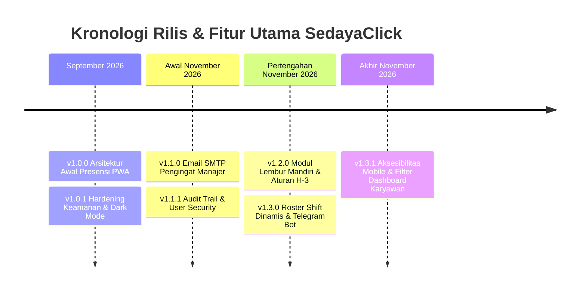

# 12. Catatan Rilis (Release Notes) & Riwayat Perubahan As-Built

| Metadata | Keterangan |
| :--- | :--- |
| **Sistem** | SedayaClick — Sistem Presensi & Penggajian Karyawan PWA |
| **Basis Analisis** | Seluruh 38 Komit Git pada Repositori (`git log --reverse`) |
| **Rentang Waktu** | 17 September 2026 – 22 November 2026 |
| **Versi Dokumen** | 1.0.0 (As-Built) |
| **Tanggal Terbit** | 23 November 2026 |

---

## Ringkasan Kronologis Versi

---

## Rincian Perubahan per Versi

### Versi 1.3.1 (22 November 2026) — Optimasi UI & Aksesibilitas Mobile
**Komit Terkait**: `5fa536e`, `f374140`
- **Fitur & Perbaikan UI**:
  - **Aksesibilitas Mobile Roster**: Menambahkan menu navigasi "Jadwal Roster" ke dalam *bottom sheet* seluler Super Admin agar pengelola dapat mengakses kalender dari smartphone.
  - **Kondisional Widget Dashboard Karyawan**: Memperbarui logika `routes/attendance.js` dan `public/employee/js/employee.js` sehingga kartu pintasan roster dan banner jadwal shift hari ini **hanya ditampilkan** bagi karyawan dengan penugasan Shift Khusus / Roster.
  - **Penyembunyian Komponen Non-Roster**: Karyawan dengan shift reguler tetap (seperti Adi Sanjaya) disajikan antarmuka bersih tanpa komponen roster yang membingungkan.

---

### Versi 1.3.0 (18 - 19 November 2026) — Sistem Roster Shift & Bot Maintenance
**Komit Terkait**: `af40997`, `3cf468e`, `35abcc8`, `fbf4561`, `db5be10`, `e8e8bb7`
- **Fitur Baru (Roster & Operasional)**:
  - **Sistem Roster Bulanan**: Membuat tabel `employee_schedules` untuk menampung jadwal bergilir bulanan tim operasional (kode: P, S, VK, VW, VH, R, PL, SAT, L/OFF).
  - **Impor & Ekspor Matriks Excel**: Menyediakan generator template Excel dinamis dan parser berkas `.xlsx` untuk memperbarui jadwal satu divisi sekaligus.
  - **Auto-Koreksi Keterlambatan Shift Siang**: Mengimplementasikan migrasi koreksi status keterlambatan absensi otomatis bagi karyawan shift siang (masuk 11:00 - 13:15 WIB).
  - **Scheduler Pengingat H-15 Menit**: Mengembangkan `utils/attendanceReminder.js` yang terintegrasi dengan jadwal roster dinamis karyawan.
- **Fitur Baru (Infrastruktur & Maintenance)**:
  - **SedayaClick Telegram Ops & Maintenance Bot**: Merilis `services/telegramBot.js` (long-polling bot) untuk remote server diagnostics, on-demand MySQL backup (`.sql.gz`), photo backup (`.tar.gz`), dan remote PM2 reload.

---

### Versi 1.2.0 (18 November 2026) — Presensi Lembur Mandiri & Aturan H-3
**Komit Terkait**: `b2a6dbb`, `af40997`
- **Fitur Baru (Lembur Mandiri)**:
  - Menambahkan kolom presensi lembur langsung di tabel `attendances` (`overtime_clock_in_time`, `overtime_clock_out_time`, `overtime_work_attachment`, `overtime_status`).
  - Kewajiban melampirkan berkas bukti pekerjaan (*work attachment*) saat Clock Out lembur.
  - Pengenalan status persetujuan baru: `under_review` (Sedang Ditinjau) pada pengajuan dan lembur.
- **Aturan Bisnis Baru**:
  - **Aturan Pengajuan H-3**: Pengajuan cuti dan izin operasional wajib diajukan minimal 3 hari sebelum tanggal mulai pelaksanaan (tipe sakit dikecualikan).
  - **Rencana Serah Terima Cuti**: Mewajibkan pengisian `handover_plan`, nama rekan pengganti, dan jabatannya pada formulir cuti tahunan.

---

### Versi 1.1.0 (02 - 12 November 2026) — Email Notification & User Profile Security
**Komit Terkait**: `4c6a1e2`, `fb0f8cb`, `d997064`, `f577f4f`, `90b6edb`, `e402fce`
- **Fitur Notifikasi Email**:
  - Integrasi Gmail SMTP melalui `nodemailer` pada `utils/mailer.js`.
  - Modul pengiriman email pengingat antrean pengajuan pending secara manual oleh Admin Manager dan Super Admin.
  - Template email HTML tabel ringkasan antrean pengajuan pending.
- **Keamanan & Antarmuka**:
  - Fitur intip password pengguna (`visible_password` via AES-256-CBC) khusus untuk wewenang Super Admin.
  - Penambahan grafik garis distribusi absensi pada dashboard KPI Super Admin.
  - Modal pop-up viewer untuk memeriksa lampiran surat dokter dan bukti kerja tanpa meninggalkan halaman.
  - Pencegahan gestur pinch-zoom dan double-tap zoom pada peramban seluler.

---

### Versi 1.0.1 (20 September 2026) — Hardening Keamanan & Mobile Fixes
**Komit Terkait**: `d1d2355`, `e94ce39`
- **Peningkatan Keamanan**:
  - Pemindahan direktori penyimpanan berkas dari publik statis ke rute terproteksi `/secure-uploads/`.
  - Penerapan rate limiting login (`express-rate-limit`) dan sanitasi nama berkas (`path.basename`).
- **Penyempurnaan PWA**:
  - Penambahan gestur *pull-to-refresh* pada dashboard karyawan.
  - Penyempurnaan layout modal responsif untuk perangkat layar kecil.

---

### Versi 1.0.0 (17 - 18 September 2026) — Rilis Awal Sistem Presensi PWA
**Komit Terkait**: `c28c8df`, `fa609a1`, `453ccfe`
- **Fitur Pondasi Utama**:
  - Inisialisasi Express backend, koneksi MySQL pool, dan konfigurasi sesi `express-mysql-session`.
  - Pendaftaran mandiri karyawan dan alur verifikasi aktivasi oleh Super Admin.
  - Clock In dan Clock Out harian dengan integrasi kamera WebRTC dan koordinat GPS satelit.
  - Perhitungan matematis durasi kerja, keterlambatan, dan lembur presisi detik (`utils/timeCalc.js`).
  - Modul formulir pengajuan izin, cuti, dan sakit.
  - Dashboard Admin Manager untuk persetujuan perizinan tim.
  - Mesin ekspor laporan kehadiran ke format CSV dan Microsoft Excel (`.xlsx`).
  - Service Worker PWA (`public/sw.js`) dan Web App Manifest (`public/manifest.json`).
