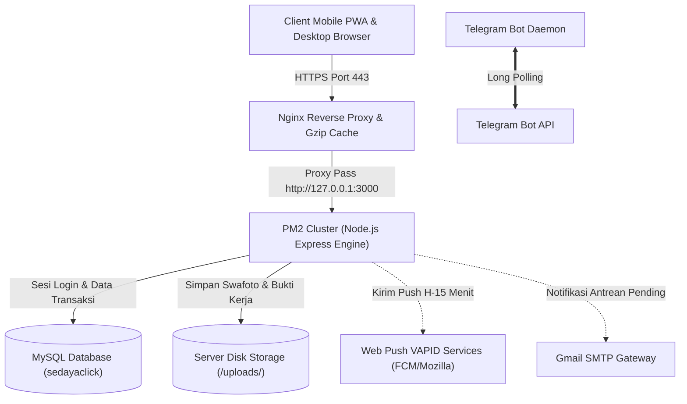
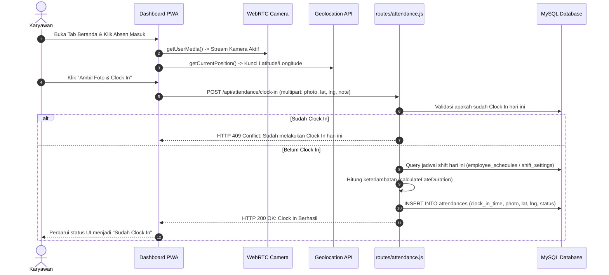
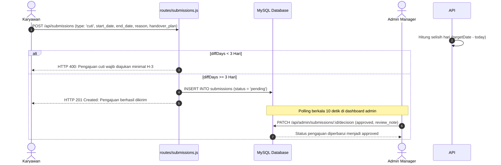
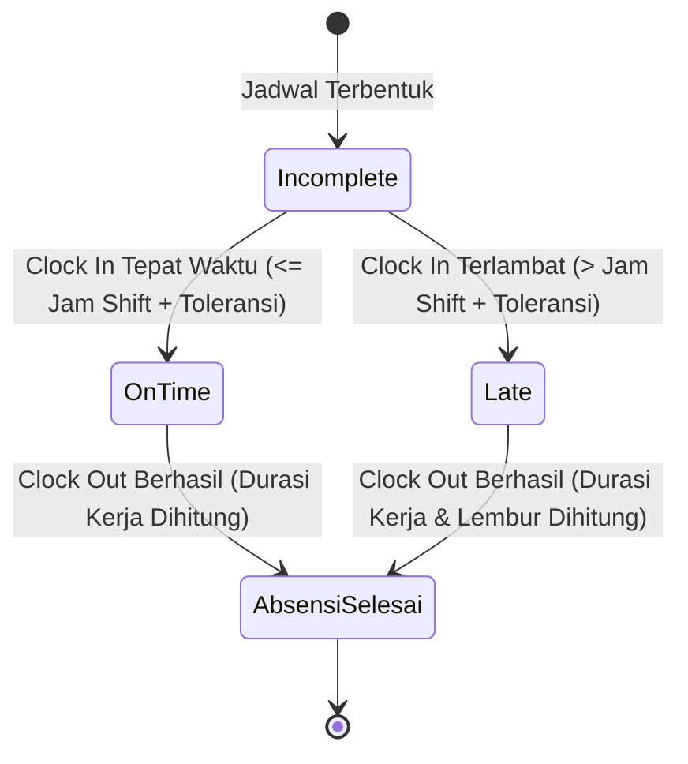
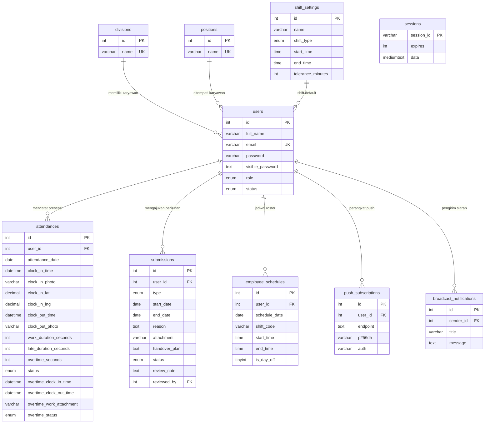
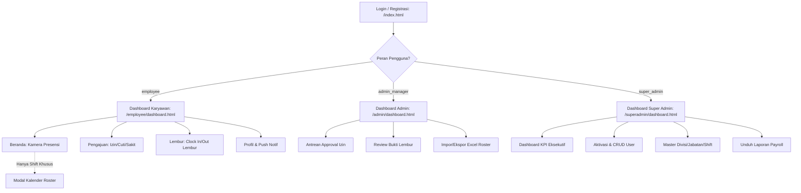

# DOKUMENTASI LENGKAP SDLC (AS-BUILT)
## SISTEM INFORMASI PRESENSI & PENGGAJIAN KARYAWAN PWA (SEDAYACLICK)
### PT RANCANG BANGUN SEDAYA

---

| Lembar Informasi Dokumen | Nilai Metadata |
| :--- | :--- |
| **Nama Sistem** | SedayaClick — Sistem Presensi & Penggajian Karyawan PWA |
| **Entitas Pemilik Sistem** | PT Rancang Bangun Sedaya |
| **Pemilik Dokumen** | Project Manager [PERLU KONFIRMASI: Nama Lengkap PM] |
| **Status Sistem** | Production / Live (Aktif Digunakan Operasional) |
| **Versi Dokumen** | 1.0.0 (Master Consolidated As-Built Documentation) |
| **Tanggal Analisis & Penyusunan** | 23 November 2026 |
| **Basis Analisis Kode** | Repositori Git Commit `f374140` (Branch `main`) |
| **Bahasa Dokumentasi** | Bahasa Indonesia Formal (Istilah teknis dalam Bahasa Inggris) |
| **Target Pembaca** | Developer Onboarding, QA Engineer, DevOps/Sysadmin, Manajemen & Auditor |

---

## DAFTAR ISI MASTER

1. [Bab 1: Discovery dan Inventaris Sistem As-Built](#bab-1-discovery-dan-inventaris-sistem-as-built)
2. [Bab 2: Gambaran Umum Proyek (Project Overview)](#bab-2-gambaran-umum-proyek-project-overview)
3. [Bab 3: Spesifikasi Kebutuhan Sistem (SRS)](#bab-3-spesifikasi-kebutuhan-sistem-srs)
4. [Bab 4: Desain Arsitektur & Rekayasa Sistem (SDD)](#bab-4-desain-arsitektur--rekayasa-sistem-sdd)
5. [Bab 5: Desain Basis Data & Kamus Data](#bab-5-desain-basis-data--kamus-data)
6. [Bab 6: Spesifikasi REST API & Kontrak Antarmuka](#bab-6-spesifikasi-rest-api--kontrak-antarmuka)
7. [Bab 7: Antarmuka Pengguna & Peta Navigasi (UI/UX)](#bab-7-antarmuka-pengguna--peta-navigasi-uiux)
8. [Bab 8: Audit Keamanan Sistem & Kepatuhan UU PDP](#bab-8-audit-keamanan-sistem--kepatuhan-uu-pdp)
9. [Bab 9: Rencana, Strategi & Katalog Pengujian (Testing)](#bab-9-rencana-strategi--katalog-pengujian-testing)
10. [Bab 10: Runbook Deployment & Operasional Server](#bab-10-runbook-deployment--operasional-server)
11. [Bab 11: Pemeliharaan Sistem & Register Utang Teknis (Technical Debt)](#bab-11-pemeliharaan-sistem--register-utang-teknis-technical-debt)
12. [Bab 12: Panduan Operasional Pengguna (User Manual)](#bab-12-panduan-operasional-pengguna-user-manual)
13. [Bab 13: Catatan Rilis & Riwayat Komit (Release Notes)](#bab-13-catatan-rilis--riwayat-komit-release-notes)
14. [Bab 14: Matriks Keterlacakan Kebutuhan (RTM)](#bab-14-matriks-keterlacakan-kebutuhan-rtm)
15. [Bab 15: Register Risiko, Asumsi Terkumpul & Glosarium Istilah](#bab-15-register-risiko-asumsi-terkumpul--glosarium-istilah)
16. [Lampiran: Ringkasan Eksekutif & 10 Temuan Terpenting](#lampiran-ringkasan-eksekutif--10-temuan-terpenting)

---

# BAB 1: DISCOVERY DAN INVENTARIS SISTEM AS-BUILT

### 1.1 Struktur Direktori Repositori
Sistem SedayaClick dibangun dengan pendekatan monolit modular berbasis Node.js yang melayani frontend statis Progressive Web App (PWA) sekaligus backend RESTful API.

```
.
├── .github/workflows/deploy.yml # CI/CD deployment via SSH ke VPS produksi
├── config/
│   ├── db.js                   # Koneksi pool MySQL (mysql2/promise) & runtime auto-migration
│   ├── schema.sql              # DDL skema database awal
│   ├── seed.js                 # Seeder data master divisi, jabatan & superadmin awal
│   └── webpush.js              # Inisialisasi VAPID Web Push (web-push)
├── deploy/
│   ├── nginx-sedayaclick.conf  # Konfigurasi reverse proxy Nginx + kompresi Gzip
│   └── setup-vps.sh            # Skrip bash otomatisasi deployment VPS Ubuntu
├── docs/                       # Bundel berkas dokumentasi SDLC sistem
├── middleware/
│   └── auth.js                 # Middleware autentikasi sesi Express & RBAC (requireRole)
├── public/                     # Aset statis client PWA
│   ├── admin/                  # Tampilan & logika dashboard Admin Manager
│   ├── employee/               # Tampilan & logika dashboard Karyawan
│   ├── superadmin/             # Tampilan & logika dashboard Super Admin
│   ├── js/                     # Modul client helper (kamera WebRTC, GPS, push, splash)
│   ├── index.html              # Landing page login & registrasi mandiri
│   ├── manifest.json           # Manifest W3C PWA standalone
│   └── sw.js                   # Service Worker (App shell caching & push handler)
├── routes/                     # Router modular Express API
│   ├── admin.js                # Modul approval pengajuan & roster Admin Manager
│   ├── attendance.js           # Modul presensi masuk/pulang & lembur mandiri
│   ├── auth.js                 # Modul otentikasi sesi & registrasi karyawan
│   ├── notifications.js        # Modul Web Push subscription & siaran broadcast
│   ├── reports.js              # Modul pelaporan multi-dimensi & ekspor CSV/Excel
│   ├── secureUploads.js        # Modul otorisasi pengunduhan berkas foto & bukti medis
│   ├── submissions.js          # Modul formulir pengajuan izin/cuti/sakit karyawan
│   └── superadmin.js           # Modul master data, manajemen user, dan KPI
├── services/
│   └── telegramBot.js          # Bot Telegram monitoring remote server & backup DB
├── utils/                      # Fungsi pembantu murni (pure domain helpers)
│   ├── attendanceReminder.js   # Background scheduler pengingat absensi H-15 menit
│   ├── crypto.js               # Enkripsi & dekripsi dua arah AES-256-CBC
│   ├── exportGenerator.js      # Generator ekspor Excel (ExcelJS) & CSV (json2csv)
│   ├── mailer.js               # Pengirim email antrean pending via Gmail SMTP
│   ├── rosterHelper.js         # Parser matriks shift Excel & resolusi kode shift
│   ├── timeCalc.js             # Kalkulasi matematis durasi kerja, telat, & lembur
│   └── uploadConfig.js         # Konfigurasi filter MIME & batas upload Multer
├── ecosystem.config.js         # Konfigurasi PM2 Cluster Mode
├── package.json                # Daftar dependensi pustaka Node.js
├── sedayaclick.sql             # SQL dump struktur database MySQL
└── server.js                   # Titik masuk utama aplikasi (Express HTTP Server)
```

### 1.2 Lingkungan Runtime & Teknologi
- **Runtime Server**: Node.js v20.x LTS pada Ubuntu 20.04/22.04 LTS x86_64 [TERVERIFIKASI: `deploy/setup-vps.sh:53-55`].
- **Web Framework**: Express.js v4.19.2 [TERVERIFIKASI: `package.json:19`].
- **Process Manager**: PM2 (Cluster Mode: `max` instances) [TERVERIFIKASI: `ecosystem.config.js:6-7`].
- **Database Engine**: MySQL Server 8.0 / MariaDB 10.4+ dengan collation `utf8mb4_unicode_ci` [TERVERIFIKASI: `config/db.js:11-23`].
- **Frontend Layer**: HTML5, Vanilla JavaScript ES6 (tanpa framework runtime client), Tailwind CSS via Play CDN [TERVERIFIKASI: `public/index.html:10`].
- **PWA Engine**: Service Worker Cache API (`public/sw.js`) dan Web App Manifest (`public/manifest.json`).

### 1.3 Daftar Dependensi Produksi (`package.json`)
[TERVERIFIKASI: `package.json:14-29`]
- `bcryptjs (^2.4.3)`: Hashing satu arah kata sandi pengguna.
- `cors (^2.8.5)`: Pengaturan Cross-Origin Resource Sharing.
- `dotenv (^16.4.5)`: Pemuatan variabel `.env` ke `process.env`.
- `exceljs (^4.4.0)`: Pustaka manipulasi dan pembuatan spreadsheet Excel `.xlsx`.
- `express (^4.19.2)`: Web framework utama HTTP server.
- `express-mysql-session (^3.0.3)`: Penyimpanan sesi login Express ke tabel MySQL `sessions`.
- `express-rate-limit (^8.7.0)`: Pembatasan laju request HTTP (anti brute-force).
- `express-session (^1.18.0)`: Middleware manajemen cookie sesi HTTP-only.
- `helmet (^8.3.0)`: Pengamanan HTTP header response.
- `json2csv (^6.0.0-alpha.2)`: Generator berkas CSV untuk ekspor data laporan.
- `multer (^1.4.5-lts.1)`: Middleware upload berkas multipart (swafoto & bukti kerja).
- `mysql2 (^3.10.0)`: Driver koneksi MySQL berbasis Promise dan connection pool.
- `nodemailer (^10.5.0)`: Pengiriman notifikasi email SMTP.
- `web-push (^3.6.7)`: Protokol push notification VAPID standar IETF.

### 1.4 Background Daemon & Schedulers
1. **Attendance Reminder Scheduler** (`utils/attendanceReminder.js`): Berjalan di background dengan interval 60 detik saat server listening [TERVERIFIKASI: `server.js:276`], bertugas memeriksa karyawan yang jadwal shiftnya dimulai dalam H-15 menit atau selesai dalam H-15 menit untuk dikirimi Web Push Notification.
2. **Telegram Ops & Maintenance Bot** (`services/telegramBot.js`): Berjalan mandiri via polling HTTP ke API Telegram [TERVERIFIKASI: `package.json:10`], memfasilitasi monitoring beban server, backup database terkompresi `.sql.gz`, arsip foto `.tar.gz`, dan restart PM2 secara remote.

### 1.5 Riwayat Git & Kontributor
- Total komit: 38 komit [TERVERIFIKASI: `git rev-list --count HEAD`].
- Komit pertama: `c28c8df` (17 September 2026).
- Komit analisis: `f374140` (22 November 2026).
- Kontributor: Muhamad Firdaus (30 komit), rendydev404 (8 komit).
- Tag versi semver git: `[TIDAK DITEMUKAN]`.

---

# BAB 2: GAMBARAN UMUM PROYEK (PROJECT OVERVIEW)

### 2.1 Masalah Bisnis yang Diselesaikan
1. **Pencegahan Kecurangan Titip Absen**: Merekam swafoto langsung dari kamera browser WebRTC dan mengunci koordinat GPS satelit secara wajib saat Clock In dan Clock Out.
2. **Digitalisasi Pengajuan Izin/Cuti/Lembur**: Menggantikan formulir fisik dengan alur persetujuan berjenjang digital (*Pending*, *Under Review*, *Approved*, *Rejected*).
3. **Fleksibilitas Shift Roster & Libur Bergilir**: Mengakomodasi shift dinamis karyawan operasional (seperti unit perhotelan/villa Casa Nawasena dan unit SSV) melalui matriks Excel bulanan.
4. **Otomatisasi Kalkulasi Durasi Jam Kerja & Payroll**: Menghitung jam kerja, durasi keterlambatan, dan jam lembur secara presisi hingga satuan detik (`HH:mm:ss`) yang dapat diekspor ke CSV/Excel.

### 2.2 Batasan Ruang Lingkup Sistem (Scope Boundaries)
- **Fitur yang Diimplementasikan (In-Scope)**:
  - Registrasi mandiri & autentikasi sesi berbasis MySQL.
  - Rate limiting percobaan login gagal (max 5x per 15 menit).
  - Clock In & Clock Out harian dengan swafoto kamera dan geolokasi GPS.
  - Presensi lembur mandiri (*Direct Overtime*) dengan bukti penyelesaian tugas.
  - Pengajuan izin, sakit, cuti (aturan H-3 & serah terima cuti), dan lembur formulir.
  - Manajemen matriks roster shift bulanan (kode: P, S, VK, VW, VH, R, PL, SAT, L/OFF).
  - Dashboard KPI eksekutif dan analitik absensi.
  - Pengingat absensi Web Push H-15 menit dan email antrean pending via SMTP Gmail.
  - Bot Telegram pemeliharaan remote server.
- **Fitur di Luar Ruang Lingkup (Out-of-Scope / Tidak Ditemukan di Kode)**:
  - **Kalkulasi Payroll Nominal Rupiah**: Tidak ada tabel nominal rupiah, potongan PPh 21, atau slip gaji PDF di kode sumber `[ASUMSI: diolah eksternal via ekspor Excel]`.
  - **Face Recognition AI / Biometrik Otomatis**: Foto wajah disimpan utuh, namun tidak diverifikasi oleh model AI/ML kecocokan wajah.
  - **Deteksi Fake GPS / Root Guard**: Tidak ada mekanisme pendeteksi bypass mock location di browser web.
  - **Aplikasi Mobile Native**: Tidak ada kode Java/Kotlin, Swift, atau Flutter; aplikasi bekerja 100% sebagai Progressive Web App (PWA).

### 2.3 Ringkasan Arsitektur Tingkat Tinggi


---

# BAB 3: SPESIFIKASI KEBUTUHAN SISTEM (SRS)

### 3.1 Aktor Sistem & Matriks Hak Akses (RBAC)
[TERVERIFIKASI: `middleware/auth.js:18-29`]
- **ACT-01: Karyawan (`employee`)**: Pengguna akhir operasional yang melakukan absensi, presensi lembur mandiri, pengajuan izin/cuti sendiri, dan melihat jadwal roster miliknya.
- **ACT-02: Admin Manager (`admin_manager`)**: Manajemen menengah yang meninjau, menyetujui, menolak, mengedit pengajuan lintas divisi, serta mengunggah matriks roster bulanan.
- **ACT-03: Super Admin (`super_admin`)**: Administrator tertinggi yang mengelola akun pengguna, master data divisi/jabatan/shift, dashboard KPI, ekspor laporan, dan broadcast notifikasi.

### 3.2 Kebutuhan Fungsional (Functional Requirements / FR-xx)

| ID FR | Modul | Deskripsi Kebutuhan Fungsional | Aktor Terkait | Rujukan Kode Sumber | MoSCoW |
| :--- | :--- | :--- | :--- | :--- | :---: |
| **FR-01** | Autentikasi | Pendaftaran mandiri akun karyawan baru dengan status awal `pending`. | Calon Karyawan | `routes/auth.js:65-98` | Must |
| **FR-02** | Autentikasi | Login menggunakan email dan kata sandi dengan sesi cookie aman `sedayaclick_sid`. | Semua Aktor | `routes/auth.js:108-160` | Must |
| **FR-03** | Keamanan | Rate limiting login maksimal 5 kegagalan per 15 menit per kombinasi IP + Email. | Tamu / User | `routes/auth.js:14-32` | Must |
| **FR-04** | Presensi | Transaksi Clock In dengan rekaman waktu server, swafoto WebRTC, dan koordinat GPS. | Karyawan | `routes/attendance.js:127-245` | Must |
| **FR-05** | Presensi | Validasi maksimal 1 transaksi Clock In per karyawan per hari kalender. | Karyawan | `routes/attendance.js:150-152` | Must |
| **FR-06** | Presensi | Transaksi Clock Out serta perhitungan otomatis durasi jam kerja, keterlambatan, dan lembur. | Karyawan | `routes/attendance.js:247-310` | Must |
| **FR-07** | Presensi | Presensi lembur langsung mandiri (*Direct Overtime*) dengan bukti berkas hasil kerja. | Karyawan | `routes/attendance.js:312-460` | Should |
| **FR-08** | Presensi | Deteksi jadwal shift roster dinamis harian (P, S, VK, VW, VH, R, PL, SAT, L/OFF). | Karyawan | `routes/attendance.js:45-74` | Must |
| **FR-09** | Pengajuan | Formulir mandiri pengajuan izin, cuti, sakit, dan lembur dengan lampiran berkas. | Karyawan | `routes/submissions.js:16-85` | Must |
| **FR-10** | Pengajuan | Penolakan otomatis atas pengajuan izin dan cuti yang diajukan kurang dari H-3 pelaksanaan. | Karyawan | `routes/submissions.js:46-59` | Must |
| **FR-11** | Pengajuan | Kewajiban pencatatan rencana serah terima tugas (*handover plan*) untuk pengajuan cuti. | Karyawan | `routes/submissions.js:63-65` | Must |
| **FR-12** | Persetujuan | Keputusan persetujuan pengajuan (*Approved*, *Rejected*, *Under Review*) beserta catatan alasan. | Admin Manager, Super Admin | `routes/admin.js:128-167` | Must |
| **FR-13** | Roster | Unduh template dan unggah matriks Excel roster shift bulanan tim operasional. | Admin Manager, Super Admin | `routes/admin.js:390-550` | Must |
| **FR-14** | Master User | Verifikasi aktivasi pendaftaran baru, CRUD user, dan fitur inspeksi password terdekripsi. | Super Admin | `routes/superadmin.js:150-315` | Must |
| **FR-15** | Master Data | Pengelolaan data master divisi, jabatan, dan pengaturan shift (`shift_settings`). | Super Admin | `routes/superadmin.js:322-448` | Must |
| **FR-16** | Dashboard | Visualisasi metrik KPI organisasi dan grafik garis tren absensi tepat waktu vs terlambat. | Super Admin | `routes/superadmin.js:21-101` | Should |
| **FR-17** | Pelaporan | Ekspor rekapitulasi data absensi dan lembur ke format Microsoft Excel (.xlsx) dan CSV. | Admin Manager, Super Admin | `routes/reports.js:63-125` | Must |
| **FR-18** | Notifikasi | Pengiriman Web Push Notification otomatis pada H-15 menit sebelum shift masuk dan pulang. | Karyawan | `utils/attendanceReminder.js` | Should |
| **FR-19** | Notifikasi | Pengiriman siaran broadcast pesan instan ke perangkat karyawan oleh Super Admin. | Super Admin | `routes/notifications.js:125-225`| Could |
| **FR-20** | Notifikasi | Pengiriman email rekap antrean pengajuan pending ke manajer via Gmail SMTP. | Admin Manager, Super Admin | `utils/mailer.js`, `routes/admin.js` | Should |
| **FR-21** | Maintenance | Pemeliharaan server remote, backup database dump `.sql.gz`, dan arsip foto via Telegram Bot. | Sysadmin / DevOps | `services/telegramBot.js` | Could |

### 3.3 Aturan Bisnis Sistem (Business Rules / BR-xx)
- **BR-01 (Batas Absensi Harian)**: Satu karyawan hanya memiliki tepat 1 baris absensi per tanggal kalender (`uniq_user_date`) [TERVERIFIKASI: `config/schema.sql:68`].
- **BR-02 (Kewajiban Swafoto & GPS)**: Clock In dan Clock Out wajib melampirkan swafoto live WebRTC dan koordinat GPS satelit [TERVERIFIKASI: `routes/attendance.js:139-145`].
- **BR-03 (Shift Reguler & Toleransi)**: Karyawan shift tetap masuk jam 08:00 WIB dengan toleransi keterlambatan (`tolerance_minutes`). Masuk > jam masuk + toleransi dicatat terlambat (`late`) [TERVERIFIKASI: `utils/timeCalc.js:41-47`].
- **BR-04 (Shift Roster & Shift Siang)**: Karyawan shift bergilir mengikuti jadwal di `employee_schedules`. Pada shift siang (13:00 - 22:00), kedatangan antara 11:00 - 13:15 WIB tidak dianggap terlambat [TERVERIFIKASI: `server.js:189-208`].
- **BR-05 (Libur Terjadwal / Day Off)**: Karyawan dengan kode shift `L` atau `OFF` atau flag `is_day_off = 1` dibebaskan dari absensi harian dan tidak dikirimi notifikasi masuk [TERVERIFIKASI: `utils/attendanceReminder.js:85-87`].
- **BR-06 (Kalkulasi Durasi Presisi)**: Durasi kerja dihitung otomatis saat Clock Out: `work_duration_seconds = clock_out_time - clock_in_time`. Kelebihan jam pulang shift dicatat sebagai `overtime_seconds` [TERVERIFIKASI: `utils/timeCalc.js:54-69`].
- **BR-07 (Presensi Lembur Mandiri)**: Lembur mandiri di luar shift normal wajib menyertakan alasan penugasan saat masuk dan wajib mengunggah berkas bukti hasil kerja saat keluar [TERVERIFIKASI: `routes/attendance.js:312-460`].
- **BR-08 (Validasi H-3 Cuti & Izin)**: Pengajuan izin operasional dan cuti tahunan wajib diajukan minimal 3 hari sebelum tanggal pelaksanaan (`diffDays >= 3`) [TERVERIFIKASI: `routes/submissions.js:46-59`].
- **BR-09 (Pengecualian Izin Sakit)**: Pengajuan sakit dapat diajukan pada hari H atau setelahnya dengan kewajiban melampirkan surat keterangan dokter [TERVERIFIKASI: `routes/submissions.js:46`].
- **BR-10 (Rencana Serah Terima Cuti)**: Pengajuan cuti tahunan wajib melampirkan uraian rencana serah terima tugas (`handover_plan`), nama rekan pengganti, dan jabatannya [TERVERIFIKASI: `routes/submissions.js:63-65`].
- **BR-11 (Siklus Keputusan Pengajuan)**: Setiap pengajuan berstatus: `pending` -> `under_review` -> `approved` / `rejected`. Keputusan persetujuan wajib menyertakan catatan peninjau [TERVERIFIKASI: `routes/admin.js:133-142`].
- **BR-12 (Zona Waktu Resmi)**: Seluruh transaksi dan perhitungan waktu dinormalisasi ke Waktu Indonesia Barat (`Asia/Jakarta` / UTC+7) [TERVERIFIKASI: `routes/attendance.js:23-28`].
- **BR-13 (Kondisional Widget Roster UI)**: Widget jadwal shift hari ini dan kalender sebulan penuh hanya ditampilkan pada dashboard karyawan yang memiliki penugasan Shift Khusus / Roster [TERVERIFIKASI: `routes/attendance.js:45-75`, `public/employee/js/employee.js:163-192`].
- **BR-14 (Inspeksi Kata Sandi Administratif)**: Super Admin memiliki hak istimewa melihat kata sandi asli pengguna yang didekripsi dua arah dari kolom `visible_password` via AES-256-CBC untuk keperluan operasional [TERVERIFIKASI: `routes/superadmin.js:150-170`, `utils/crypto.js`].

---

# BAB 4: DESAIN ARSITEKTUR & REKAYASA SISTEM (SDD)

### 4.1 Sequence Diagram: Alur Presensi Masuk (Clock In)


### 4.2 Sequence Diagram: Pengajuan Cuti & Validasi H-3


### 4.3 State Transition Diagrams


### 4.4 Algoritma Inti: Kalkulasi Waktu & Enkripsi Kata Sandi
1. **Kalkulasi Keterlambatan (`calculateLateDuration`)**:
   `scheduledStart = Date(attendanceDate + "T" + shiftStartTime) + toleranceMinutes`. Selisih detik `diff = (clockInTime - scheduledStart) / 1000`. Jika `diff > 0`, maka dicatat sebagai durasi terlambat dalam detik.
2. **Kalkulasi Durasi Kerja (`calculateWorkDuration`)**:
   `work_duration_seconds = (clock_out_time - clock_in_time) / 1000`.
3. **Enkripsi Kata Sandi AES-256-CBC (`encryptPassword`)**:
   Kunci 256-bit diturunkan dari `SHA256(SESSION_SECRET)`. Menggunakan random IV 16-byte dengan cipher `aes-256-cbc`. Disimpan dalam format string `${ivHex}:${encryptedHex}` di kolom `users.visible_password`.

---

# BAB 5: DESAIN BASIS DATA & KAMUS DATA

### 5.1 Entity Relationship Diagram (ERD)


### 5.2 Kamus Data Ringkas Tabel Utama

#### Tabel `users`
- `id` (INT Auto PK), `full_name` (VARCHAR 100), `email` (VARCHAR 100 Unique), `password` (VARCHAR 255 Bcrypt), `visible_password` (TEXT AES Cipher), `whatsapp` (VARCHAR 20), `address` (TEXT), `division_id` (INT FK), `position_id` (INT FK), `shift_id` (INT FK), `role` (ENUM 'employee','admin_manager','super_admin'), `status` (ENUM 'pending','active','inactive'), `created_at`, `updated_at`.

#### Tabel `attendances`
- `id` (INT Auto PK), `user_id` (INT FK), `attendance_date` (DATE, Unique compound dengan user_id), `clock_in_time` (DATETIME), `clock_in_photo` (VARCHAR 255), `clock_in_lat` & `clock_in_lng` (DECIMAL 10,7), `clock_out_time` (DATETIME), `clock_out_photo` (VARCHAR 255), `work_duration_seconds` (INT), `late_duration_seconds` (INT), `overtime_seconds` (INT), `status` (ENUM 'on_time','late','early_leave','incomplete'), `overtime_clock_in_time` (DATETIME), `overtime_clock_out_time` (DATETIME), `overtime_work_attachment` (VARCHAR 255), `overtime_status` (ENUM 'pending','under_review','approved','rejected').

#### Tabel `submissions`
- `id` (INT Auto PK), `user_id` (INT FK), `type` (ENUM 'izin','cuti','sakit','lembur'), `start_date` & `end_date` (DATE), `start_time` & `end_time` (TIME), `reason` (TEXT), `attachment` (VARCHAR 255), `handover_plan` (TEXT), `handover_to_name` (VARCHAR 255), `handover_to_position` (VARCHAR 255), `status` (ENUM 'pending','under_review','approved','rejected'), `review_note` (TEXT), `reviewed_by` (INT FK), `reviewed_at` (DATETIME).

#### Tabel `employee_schedules`
- `id` (INT Auto PK), `user_id` (INT FK), `schedule_date` (DATE), `shift_code` (VARCHAR 20: P, S, VK, VW, VH, R, PL, SAT, L, OFF), `start_time` & `end_time` (TIME), `is_day_off` (TINYINT 1), `notes` (VARCHAR 255). Compound Unique Key: `(user_id, schedule_date)`.

---

# BAB 6: SPESIFIKASI REST API & KONTRAK DATA

### 6.1 Ringkasan Katalog Endpoint Utama
- **Autentikasi (`routes/auth.js`)**:
  - `GET /api/auth/meta`: Mengambil master divisi & jabatan untuk formulir registrasi.
  - `POST /api/auth/register`: Pendaftaran mandiri akun karyawan (status pending).
  - `POST /api/auth/login`: Otentikasi masuk dan pembentukan sesi cookie `sedayaclick_sid`.
  - `GET /api/auth/me`: Verifikasi sesi login aktif saat ini.
  - `POST /api/auth/logout`: Menghancurkan sesi pengguna.
- **Presensi Karyawan (`routes/attendance.js`)**:
  - `GET /api/attendance/today`: Mengambil status absensi dan shift harian karyawan login.
  - `POST /api/attendance/clock-in`: Rekam presensi masuk (multipart: `photo`, `latitude`, `longitude`, `note`).
  - `POST /api/attendance/clock-out`: Rekam presensi pulang dan kalkulasi durasi kerja/lembur.
  - `POST /api/attendance/overtime/clock-in`: Presensi masuk lembur mandiri.
  - `POST /api/attendance/overtime/clock-out`: Presensi pulang lembur mandiri (wajib `work_attachment`).
  - `GET /api/attendance/my-roster`: Mengambil matriks jadwal roster bulanan karyawan.
- **Pengajuan Karyawan (`routes/submissions.js`)**:
  - `POST /api/submissions`: Formulir izin/cuti/sakit/lembur (multipart, validasi cuti H-3).
  - `GET /api/submissions/mine`: Riwayat pengajuan milik sendiri.
- **Admin Manager (`routes/admin.js`)**:
  - `GET /api/admin/submissions/pending`: Antrean pengajuan perizinan pending.
  - `PATCH /api/admin/submissions/:id/decision`: Persetujuan pengajuan (`approved`, `rejected`, `under_review`).
  - `GET /api/admin/roster/template` & `POST /api/admin/roster/upload`: Unduh template & upload Excel roster.
- **Super Admin (`routes/superadmin.js`)**:
  - `GET /api/superadmin/dashboard/summary`: Metrik KPI organisasi dan grafik garis kehadiran.
  - `GET /api/superadmin/users` & `PATCH /api/superadmin/users/:id/status`: Manajemen user & aktivasi akun.
  - `GET/POST/PUT/DELETE /api/superadmin/shifts`: CRUD pengaturan shift kerja.
- **Pelaporan (`routes/reports.js`)**:
  - `GET /api/reports/attendance`: Data tabel absensi terfilter multi-dimensi.
  - `GET /api/reports/export/excel` & `/csv`: Ekspor berkas spreadsheet laporan.
- **Keamanan Berkas (`routes/secureUploads.js`)**:
  - `GET /secure-uploads/attendance/:filename`: Akses foto swafoto terotorisasi.
  - `GET /secure-uploads/submissions/:filename`: Akses bukti surat dokter terotorisasi.

---

# BAB 7: ANTARMUKA PENGGUNA & PETA NAVIGASI (UI/UX)

### 7.1 Inventaris Halaman Utama
1. **Halaman Autentikasi (`index.html`)**: Kartu glassmorphic login, modal registrasi mandiri dropdown dinamis, dan banner pemicu instalasi PWA.
2. **Dashboard Karyawan (`employee/dashboard.html`)**: Mobile-first viewport (420px - 600px). Memuat Jam Digital Server WIB, Status Kehadiran, Komponen Kamera WebRTC Viewfinder, Banner Jadwal Shift Hari Ini, Tombol Kalender Roster Sebulan Penuh, serta Floating Bottom Bar (Beranda, Pengajuan, Lembur, Profil).
3. **Dashboard Admin Manager (`admin/dashboard.html`)**: Filter divisi real-time, antrean perizinan pending, tinjauan lembur langsung dengan berkas hasil kerja, serta modul impor/ekspor matriks roster Excel.
4. **Dashboard Super Admin (`superadmin/dashboard.html`)**: Sidebar navigasi eksekutif, kartu KPI (Hadir, Terlambat, Pending, Karyawan Aktif), grafik garis tren absensi, verifikasi akun pending, dan manajemen intip kata sandi.

### 7.2 Diagram Peta Navigasi Sistem


---

# BAB 8: AUDIT KEAMANAN SISTEM & KEPATUHAN UU PDP

### 8.1 Register Temuan Keamanan (SEC-xx)
- **SEC-01 (Tinggi / High)**: Kredensial email cadangan dan password Base64 tertulis mentah di `utils/mailer.js:10-14`. Solusi: Hapus fallback dan wajibkan pembacaan murni dari `.env`.
- **SEC-02 (Tinggi / High)**: Kolom `visible_password` menyimpan kata sandi terenkripsi dua arah yang dapat didekripsi Super Admin. Solusi: Hapus fitur intip password demi standar zero-knowledge.
- **SEC-03 (Sedang / Medium)**: Penonaktifan Content Security Policy (`contentSecurityPolicy: false`) pada Helmet di `server.js:38`. Solusi: Bangun Tailwind CSS lokal dan aktifkan kembali CSP Helmet.
- **SEC-04 (Sedang / Medium)**: Ketiadaan token Anti-CSRF eksplisit, hanya mengandalkan atribut cookie `SameSite: 'lax'`. Solusi: Terapkan custom header request atau token CSRF.
- **SEC-05 (Rendah / Low)**: Cookie sesi disetel `secure: false` di level kode Express. Solusi: Ubah menjadi dinamis berbasis `NODE_ENV === 'production'`.
- **SEC-06 (Rendah / Low)**: Fallback seed kriptografi statis di `utils/crypto.js:9`. Solusi: Wajibkan `SESSION_SECRET` disetel di production.

### 8.2 Analisis Kesenjangan Kepatuhan UU PDP (UU No. 27 Tahun 2022)
- **Data Pribadi yang Dikelola**: Identitas umum (Nama, Email, WhatsApp, Alamat), Data Biometrik Spesifik (Swafoto wajah masuk/pulang), Data Lokasi Satelit (GPS real-time), dan Data Kesehatan (Surat dokter perizinan sakit).
- **Hal yang Belum Terpenuhi**:
  1. *Consent Mandatori (Pasal 20)*: Belum ada checkbox persetujuan syarat privasi dan pemrosesan data biometrik/lokasi saat pendaftaran akun baru.
  2. *Enkripsi Penyimpanan Media (Pasal 35)*: Berkas foto dan surat medis di `/uploads/` disimpan dalam bentuk berkas biasa tanpa enkripsi at-rest pada disk VPS.
  3. *Hak Pembaruan Data Mandiri (Pasal 36)*: Karyawan belum dapat memperbarui data profilnya secara mandiri tanpa bantuan Super Admin.

---

# BAB 9: RENCANA, STRATEGI & KATALOG PENGUJIAN (TESTING)

### 9.1 Katalog Kasus Uji As-Built (TC-xx)
- **TC-01 s.d TC-06 (Autentikasi)**: Uji registrasi berhasil, tolak email duplikat, tolak password < 6 karakter, tolak login akun pending, login sukses cookie sesi, dan rate limit 5 kegagalan per 15 menit.
- **TC-07 s.d TC-15 (Presensi Harian)**: Uji clock in tepat waktu, clock in batas toleransi 15 menit, clock in terlambat, tolak clock in duplikat, tolak clock in tanpa foto/GPS, toleransi kedatangan shift siang 11:30 WIB, dan kalkulasi durasi kerja saat clock out.
- **TC-16 s.d TC-18 (Lembur Mandiri)**: Uji clock in lembur, tolak clock out lembur tanpa bukti kerja, dan kalkulasi durasi lembur mandiri.
- **TC-19 s.d TC-23 (Pengajuan Perizinan)**: Uji pengajuan cuti memenuhi H-3, tolak cuti mendadak (< H-3), izin sakit hari-H diterima, tolak cuti tanpa rencana serah terima tugas, dan tolak tanggal selesai mendahului tanggal mulai.
- **TC-24 s.d TC-28 (Manajerial & Roster)**: Uji persetujuan cuti disetujui, tolak penolakan cuti tanpa catatan alasan, penandaan status `under_review`, impor matriks Excel valid, dan tolak upload file non-Excel.
- **TC-29 s.d TC-31 (Keamanan Berkas / Secure Uploads)**: Uji akses foto absensi milik sendiri (diizinkan HTTP 200), tolak akses foto karyawan lain oleh sesama karyawan (HTTP 403), dan akses penuh seluruh berkas oleh Admin Manager (HTTP 200).

---

# BAB 10: RUNBOOK DEPLOYMENT & OPERASIONAL SERVER

### 10.1 Prosedur Rilis & Deployment di VPS
1. **Otomatis via GitHub Actions**: Komit di branch `main` memicu workflow `.github/workflows/deploy.yml` yang menghubungkan SSH ke VPS, menarik kode terbaru via `git reset --hard origin/main`, mengeksekusi `npm install --production`, dan reload PM2 zero-downtime.
2. **Manual via Terminal SSH**:
   ```bash
   cd /var/www/sedayaclick
   git fetch origin main && git reset --hard origin/main
   npm install --production
   pm2 reload ecosystem.config.js --env production
   pm2 logs sedayaclick --lines 20 --nostream
   ```

### 10.2 Backup & Rollback Cepat
- **Backup Database**: Jalankan perintah `/backup_db` di bot Telegram atau via CLI:
  `mysqldump -u sedaya_user -p sedayaclick | gzip > backup_$(date +%F).sql.gz`.
- **Prosedur Rollback**: Jika terjadi kesalahan rilis kode baru, eksekusi:
  `git reset --hard <commit-hash-stabil> && pm2 reload sedayaclick`.

---

# BAB 11: PEMELIHARAAN SISTEM & REGISTER UTANG TEKNIS

### 11.1 Register Utang Teknis (TD-xx)
- **TD-01 (Tinggi / High - Usaha M)**: Ketiadaan automated test suites (Jest/Supertest) yang membahayakan stabilitas rilis.
- **TD-02 (Sedang / Medium - Usaha M)**: Tailwind CSS via Play CDN menyebabkan CSP dimatikan.
- **TD-03 (Sedang / Medium - Usaha M)**: Runtime auto-migration saat startup server memicu perebutan lock database pada PM2 cluster.
- **TD-04 (Tinggi / High - Usaha L)**: Penyimpanan swafoto di disk lokal VPS memicu risiko kepenuhan disk jangka panjang.
- **TD-05 (Sedang / Medium - Usaha S)**: Dependensi versi alpha `json2csv: ^6.0.0-alpha.2` di lingkungan produksi.
- **TD-06 (Rendah / Low - Usaha S)**: Duplikasi kode query migrasi di `server.js` dan `config/db.js`.
- **TD-07 (Rendah / Low - Usaha S)**: Cache konfirmasi 2 langkah bot Telegram tersimpan di in-memory Map RAM.
- **TD-08 (Rendah / Low - Usaha M)**: Polling client 10 detik tanpa WebSockets / Server-Sent Events.

---

# BAB 12: PANDUAN OPERASIONAL PENGGUNA (USER MANUAL)

### 12.1 Karyawan (`employee`)
1. **Pasang PWA**: Buka `https://sedayaclick.cloud` di Chrome Android -> "Tambahkan ke Layar Utama", atau di Safari iOS -> ikon Share -> "Add to Home Screen".
2. **Clock In**: Buka Beranda -> Klik "ABSEN MASUK (Aktifkan Kamera)" -> Izinkan Kamera & GPS -> Arahkan wajah -> Klik "Ambil Foto & Clock In".
3. **Clock Out**: Buka Beranda jam pulang -> Klik "ABSEN PULANG" -> Ambil foto & konfirmasi.
4. **Pengajuan Cuti**: Buka Tab Pengajuan -> Buat Pengajuan Baru -> Pilih Cuti (Wajib diajukan >= H-3) -> Isi rencana serah terima dan nama rekan pengganti -> Kirim.

### 12.2 Admin Manager (`admin_manager`)
1. **Persetujuan Perizinan**: Buka `/admin/dashboard.html` -> Periksa tab Pengajuan Pending -> Klik *Setujui*, *Tolak* (wajib alasan), atau *Tinjau*.
2. **Kelola Roster**: Buka Tab Roster -> Unduh Template Excel -> Isi kode P/S/VK/VW/VH/R/L -> Unggah file Excel ke dashboard.

### 12.3 Super Admin (`super_admin`)
1. **Aktivasi Akun**: Buka `/superadmin/dashboard.html` -> Menu Persetujuan User Pending -> Klik "Aktifkan Akun".
2. **Ekspor Payroll**: Buka Menu Laporan -> Pilih Rentang Tanggal & Divisi -> Klik "Ekspor Excel (.xlsx)".

---

# BAB 13: CATATAN RILIS & RIWAYAT KOMIT (RELEASE NOTES)

- **v1.3.1 (22 Nov 2026)**: Aksesibilitas roster mobile Super Admin dan penyembunyian komponen roster untuk karyawan shift reguler (`f374140`).
- **v1.3.0 (18-19 Nov 2026)**: Matriks roster dinamis bulanan, migrasi toleransi shift siang, dan rilis SedayaClick Telegram Maintenance Bot (`e8e8bb7`).
- **v1.2.0 (18 Nov 2026)**: Modul presensi lembur mandiri dengan bukti hasil kerja, status `under_review`, dan aturan cuti H-3 (`b2a6dbb`).
- **v1.1.0 (02-12 Nov 2026)**: Notifikasi email antrean pending via Gmail SMTP dan fitur intip password karyawan Super Admin (`f577f4f`).
- **v1.0.1 (20 Sep 2026)**: Proteksi rute `/secure-uploads/`, rate limiting login, dan pull-to-refresh mobile PWA (`d1d2355`).
- **v1.0.0 (17 Sep 2026)**: Rilis awal arsitektur presensi WebRTC, geolokasi GPS, sesi MySQL, dan ekspor laporan Excel/CSV (`c28c8df`).

---

# BAB 14: MATRIKS KETERLACAKAN KEBUTUHAN (RTM)

| ID Kebutuhan (FR) | Deskripsi Fungsional | Berkas Kode Implementasi | Tabel Basis Data | Endpoint API | ID Kasus Uji |
| :--- | :--- | :--- | :--- | :--- | :--- |
| **FR-01** | Registrasi Karyawan Baru | `routes/auth.js:65-98` | `users` | `POST /api/auth/register` | TC-01, TC-02, TC-03 |
| **FR-02** | Otentikasi & Sesi Login | `routes/auth.js:108-160` | `users`, `sessions` | `POST /api/auth/login` | TC-04, TC-05 |
| **FR-03** | Rate Limiter Login | `routes/auth.js:14-32` | *(In-Memory)* | `POST /api/auth/login` | TC-06 |
| **FR-04** | Clock In Swafoto & GPS | `routes/attendance.js:127-245` | `attendances` | `POST /api/attendance/clock-in` | TC-07, TC-08, TC-09 |
| **FR-05** | Batas 1 Clock In / Hari | `routes/attendance.js:150-152` | `attendances` | `POST /api/attendance/clock-in` | TC-10 |
| **FR-06** | Clock Out & Durasi Kerja | `routes/attendance.js:247-310` | `attendances` | `POST /api/attendance/clock-out` | TC-14, TC-15 |
| **FR-07** | Presensi Lembur Mandiri | `routes/attendance.js:312-460` | `attendances` | `POST /api/attendance/overtime/*` | TC-16, TC-17, TC-18 |
| **FR-08** | Resolusi Roster Dinamis | `routes/attendance.js:45-74` | `employee_schedules` | `GET /api/attendance/today` | TC-13, TC-27 |
| **FR-09** | Formulir Izin/Cuti/Sakit | `routes/submissions.js:16-85` | `submissions` | `POST /api/submissions` | TC-19, TC-21, TC-23 |
| **FR-10** | Validasi Cuti & Izin H-3 | `routes/submissions.js:46-59` | `submissions` | `POST /api/submissions` | TC-20 |
| **FR-11** | Serah Terima Tugas Cuti | `routes/submissions.js:63-65` | `submissions` | `POST /api/submissions` | TC-22 |
| **FR-12** | Approval Pengajuan Manajer | `routes/admin.js:128-167` | `submissions` | `PATCH /submissions/:id/decision`| TC-24, TC-25, TC-26 |
| **FR-13** | Impor/Ekspor Excel Roster | `routes/admin.js:390-550` | `employee_schedules` | `POST /api/admin/roster/upload` | TC-27, TC-28 |
| **FR-14** | Master User & Intip Password | `routes/superadmin.js:150-315` | `users` | `GET/POST /api/superadmin/users` | TC-01, TC-04 |
| **FR-15** | Master Divisi/Jabatan/Shift | `routes/superadmin.js:322-448` | `divisions`, `shift_settings` | `GET/POST /api/superadmin/*` | *(Admin Functional)* |
| **FR-16** | Dashboard KPI Eksekutif | `routes/superadmin.js:21-101` | `attendances`, `submissions` | `GET /api/superadmin/dashboard/summary`| *(Analytics)* |
| **FR-17** | Ekspor Laporan Excel/CSV | `routes/reports.js:63-125` | `attendances`, `users` | `GET /api/reports/export/*` | *(Reporting)* |
| **FR-18** | Push Pengingat H-15 Menit | `utils/attendanceReminder.js` | `push_subscriptions` | *(Background Cron 60s)* | *(Daemon Test)* |
| **NFR-04**| Proteksi Berkas Unggahan | `routes/secureUploads.js` | `attendances`, `submissions` | `GET /secure-uploads/*` | TC-29, TC-30, TC-31 |

---

# BAB 15: REGISTER RISIKO, ASUMSI TERKUMPUL & GLOSARIUM ISTILAH

### 15.1 Register Risiko (RSK-xx)
- **RSK-01 (Tinggi / High)**: Kepenuhan disk penyimpanan VPS akibat pertumbuhan berkas foto presensi harian (~14 GB/tahun per 100 staf). Mitigasi: Operasikan pembersihan berkala via Telegram bot dan migrasi ke Cloud Object Storage S3/R2.
- **RSK-02 (Sedang / Medium)**: Kegagalan pengiriman email notifikasi akibat limit kuota akun Gmail personal. Mitigasi: Beralih ke Transactional Email API berbayar.
- **RSK-03 (Sedang / Medium)**: Tabrakan lock DDL skema saat PM2 cluster boot. Mitigasi: Pisahkan script migrasi dari runtime Express.
- **RSK-04 (Sedang / Medium)**: Risiko pemalsuan lokasi satelit (Fake GPS) pada ponsel Android. Mitigasi: Validasi visual swafoto kantor dan pertimbangkan evaluasi Play Integrity API.
- **RSK-05 (Sedang / Medium)**: Pelanggaran kepatuhan UU PDP akibat fitur intip kata sandi. Mitigasi: Hapus kolom `visible_password`.
- **RSK-06 (Rendah / Low)**: Ketergantungan CDN eksternal Tailwind Play CDN. Mitigasi: Kompilasi CSS secara offline.

### 15.2 Daftar Asumsi & Hal yang Perlu Dikonfirmasi
1. **[ASUMSI-01] Penggajian Nominal Diolah Eksternal**: Sistem tidak memiliki tabel perhitungan gaji rupiah; diasumsikan data jam kerja diolah eksternal oleh bagian Finance.
2. **[PERLU KONFIRMASI-01] Nama Resmi Project Manager**: Membutuhkan nama lengkap PM untuk pengesahan formal dokumen ini.
3. **[PERLU KONFIRMASI-02] Penunjukan DPO**: Apakah telah ditunjuk penanggung jawab kepatuhan UU PDP internal di PT Rancang Bangun Sedaya?
4. **[PERLU KONFIRMASI-03] Kebijakan Fitur Intip Password**: Apakah fitur `visible_password` disetujui untuk dihapus demi standar keamanan ISO 27001?
5. **[PERLU KONFIRMASI-04] Penegakan Pemblokiran Radius Geofencing**: Apakah sistem perlu mengaktifkan pemblokiran mutlak jika GPS karyawan berada di luar radius 150 meter dari kantor?

### 15.3 Glosarium Singkat
- **Clock In / Out**: Transaksi pencatatan waktu masuk dan kepulangan kerja karyawan.
- **Day Off**: Hari libur terjadwal bergilir (*rolling day off*) pada jadwal roster.
- **Handover Plan**: Rencana serah terima tanggung jawab pekerjaan saat pengajuan cuti.
- **PWA**: *Progressive Web Application*, aplikasi web yang dapat diinstal dan berjalan layaknya aplikasi native seluler.
- **RBAC**: *Role-Based Access Control*, pembatasan izin fitur berdasarkan peran (`employee`, `admin_manager`, `super_admin`).
- **Roster**: Matriks jadwal kerja bergilir bulanan tim operasional (kode P, S, VK, VW, VH, R, PL, SAT, L/OFF).
- **Under Review**: Status pengajuan yang sedang ditinjau sebelum diputuskan disetujui atau ditolak.

---

# LAMPIRAN: RINGKASAN EKSEKUTIF & 10 TEMUAN TERPENTING

1. **[SEC-01] Kredensial Email Gmail Tertulis Mentah di Kode Sumber (`utils/mailer.js:10-14`) — *Tingkat: TINGGI***: Fallback username dan password Base64 ter-commit di repositori.
2. **[SEC-02] Kolom `visible_password` Menyimpan Kata Sandi Terdekripsi Dua Arah — *Tingkat: TINGGI***: Bertentangan dengan prinsip zero-knowledge authentication.
3. **[RSK-01 / TD-04] Swafoto Presensi Disimpan di Disk Lokal VPS — *Tingkat: TINGGI***: Menimbulkan risiko kepenuhan disk 40 GB dalam 12-18 bulan (~14 GB/tahun).
4. **[TD-01] Repositori Belum Memiliki Automated Test Suite — *Tingkat: TINGGI***: Tidak ada pengujian otomatis unit/integration (Jest/Supertest).
5. **[RSK-03 / TD-03] Auto-Migration DDL Dijalankan di Runtime Startup — *Tingkat: SEDANG***: Berpotensi memicu race condition DDL lock pada PM2 cluster.
6. **[SEC-03 / TD-02] Content Security Policy (CSP) Dimatikan di Helmet — *Tingkat: SEDANG***: Dinyatakan `contentSecurityPolicy: false` demi Tailwind CDN.
7. **[SEC-04] Ketiadaan Token Anti-CSRF Eksplisit — *Tingkat: SEDANG***: Transaksi hanya mengandalkan cookie sesi `SameSite: 'lax'`.
8. **[RSK-02] Ketergantungan SMTP pada Akun Gmail Personal — *Tingkat: SEDANG***: Berisiko terkena batasan kuota kirim harian Google (500 email/hari).
9. **[UU PDP] Belum Ada Checkbox Consent Privasi saat Pendaftaran Akun — *Tingkat: SEDANG***: Belum memenuhi syarat persetujuan pemrosesan data biometrik/lokasi UU No. 27/2022.
10. **[TD-05] Paket `json2csv` Masih Menggunakan Versi Alpha di Production — *Tingkat: RENDAH/SEDANG***: Terpasang versi `^6.0.0-alpha.2` yang belum berstatus rilis stabil.
